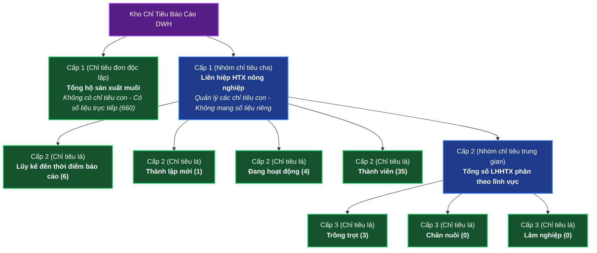
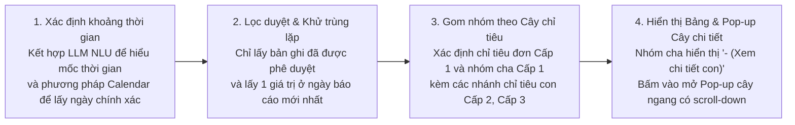
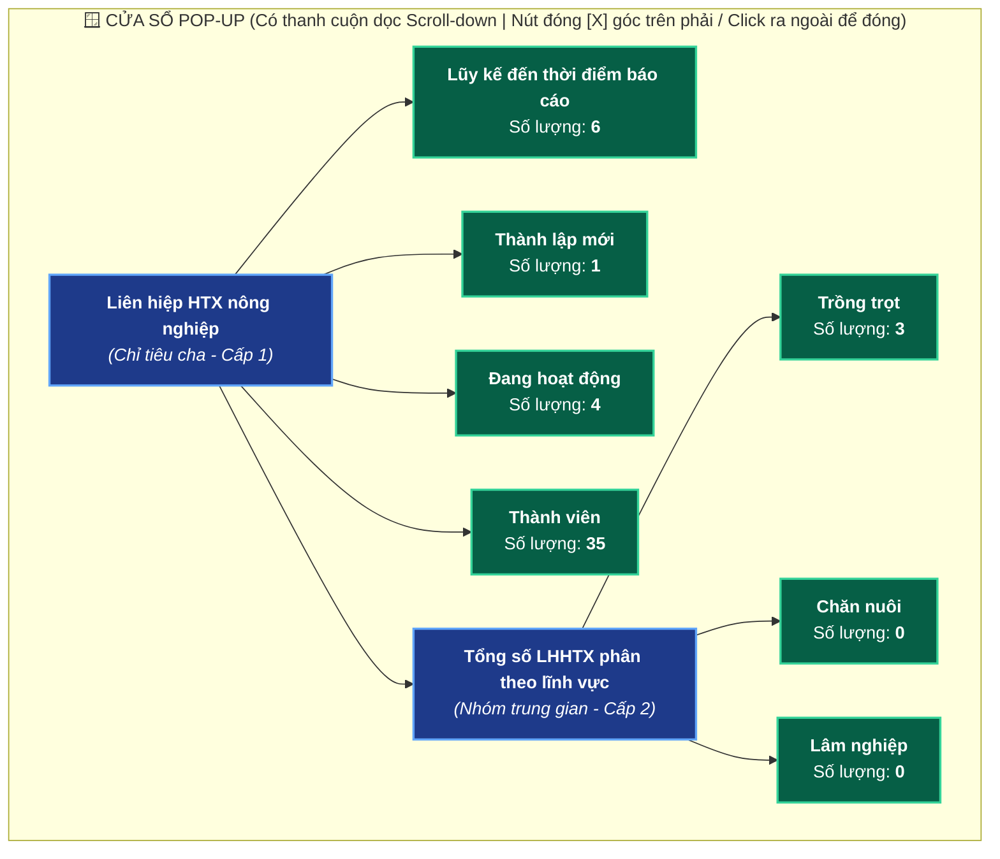
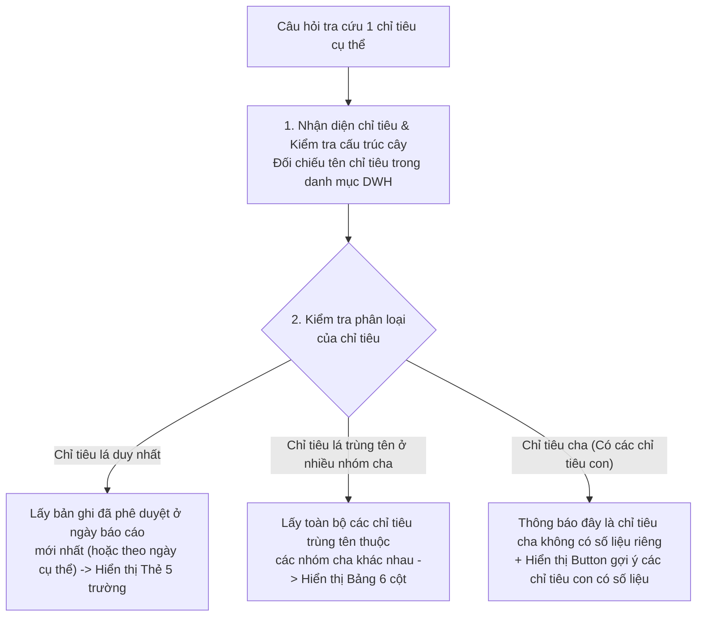
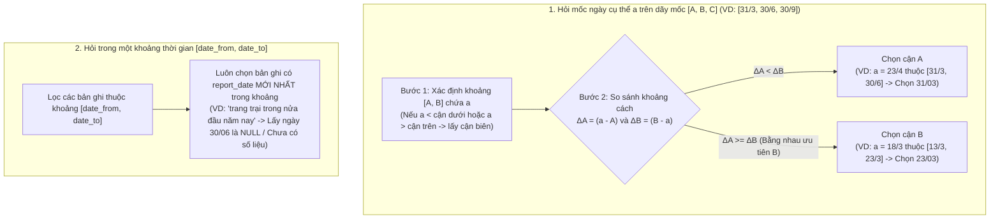
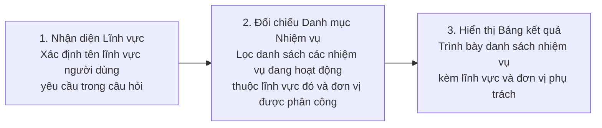
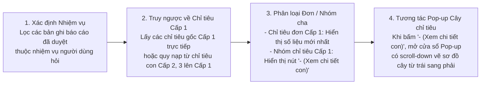

# ĐẶC TẢ YÊU CẦU PHẦN MỀM (SRS): CÁC LOẠI CÂU HỎI TRA CỨU KHO DỮ LIỆU DWH

> [!IMPORTANT]
> **Chuẩn mực áp dụng:** IEEE Std 830-1998 / ISO/IEC/IEEE 29148:2018 & Arc42 Architecture Blueprint.
> **Phạm vi dữ liệu tham chiếu:** Kho dữ liệu báo cáo hành chính công vụ tỉnh Lâm Đồng (kỳ báo cáo năm 2026).

---

## 1. TỔNG QUAN CẤU TRÚC DỮ LIỆU & QUY CHUẨN HỆ THỐNG

### 1.1. Mô hình Cây Phân Cấp Chỉ Tiêu Không Đồng Đều (1 đến 3 Cấp)
Trong Kho Dữ Liệu (DWH), các chỉ tiêu báo cáo tồn tại dưới dạng **Cây phân cấp độ sâu biến thiên từ Cấp 1 đến Cấp 3**:



> [!WARNING]
> **Hai đặc tính nghiệp vụ cốt lõi của Cây chỉ tiêu trong DWH:**
> 1. **Hiện tượng trùng tên chỉ tiêu con giữa các nhánh cha:** Có **17 tên chỉ tiêu lá (41 bản ghi)** ở Cấp 2 và Cấp 3 trùng tên hoàn toàn giữa các nhóm cha khác nhau (Ví dụ: *"Trồng trọt"*, *"Chăn nuôi"*, *"Lâm nghiệp"*, *"Thành lập mới"*, *"Đang hoạt động"*, *"Thành viên"* cùng xuất hiện dưới 4 nhóm: *HTX nông nghiệp*, *Liên hiệp HTX nông nghiệp*, *Tổ hợp tác*, *Trang trại*).
> 2. **Hiện tượng chỉ tiêu cha đóng vai trò đề mục gom nhóm:** Các chỉ tiêu Cấp 1 có chỉ tiêu con bên dưới (như *"Liên hiệp HTX nông nghiệp"*, *"Trang trại"*, *"Chương trình OCOP"*) đóng vai trò là nhóm cha nên không mang giá trị riêng lẻ, trong khi các chỉ tiêu Cấp 1 độc lập (như *"Tổng hộ sản xuất muối"*) có số liệu trực tiếp.

### 1.2. Quy Chuẩn Chung Về Xử Lý Ngôn Ngữ Tự Nhiên (NLU) & Giao Diện Cửa Sổ Pop-up
1. **Quy chuẩn suy luận NLU tại Module 3 & Module 4:** Toàn bộ các tác vụ phân tích ý định, bóc tách thực thể và hiểu ngôn ngữ tự nhiên trong Module 3 và Module 4 đều áp dụng phương pháp **Few-Shot kết hợp Chain-of-Thought (CoT) Prompting** trên mô hình ngôn ngữ lớn (LLM) để đạt khả năng tổng quát hóa cao, tuyệt đối không phụ thuộc vào từ khóa cứng hay biểu thức chính quy (Regex/Heuristic).
2. **Quy chuẩn lọc thời gian (LLM NLU + Calendar):** Đối với mọi yêu cầu lọc theo thời gian, hệ thống kết hợp **LLM để hiểu ngữ nghĩa thời gian theo hướng tổng quát** (tháng, quý, nửa đầu năm, lũy kế...) và sử dụng **phương pháp tính lịch (`calendar`)** để xác định chính xác ngày bắt đầu và ngày kết thúc tương ứng, không để LLM tự nhẩm ngày.
3. **Quy chuẩn bắt buộc đối với toàn bộ Cửa sổ Pop-up trong hệ thống `IPGov_Chatbot`:**
   - **Thanh cuộn dọc (`Scroll-down`):** Tất cả các cửa sổ Pop-up hiển thị trong hệ thống bắt buộc phải tích hợp thanh cuộn dọc (`scroll-down`) để người dùng cuộn xuống xem đầy đủ các thành phần/chỉ tiêu bên dưới, tuyệt đối giữ nguyên kích thước chuẩn của chữ (text) và ô hiển thị, tránh việc thu nhỏ nội dung khi có nhiều phần tử.
   - **Cơ chế đóng cửa sổ Pop-up:** Người dùng có thể đóng cửa sổ Pop-up bất kỳ lúc nào bằng cách bấm vào nút **`'X'`** ở góc trên cùng bên phải của cửa sổ hoặc **bấm chuột vào một vùng bất kỳ bên ngoài cửa sổ Pop-up**.

### 1.3. Bảng Tổng Hợp Trạng Thái 4 Loại Câu Hỏi Nghiệp Vụ

| Mã Yêu Cầu | Tên Loại Câu Hỏi Nghiệp Vụ | Trạng Thái Hiện Tại |
| :---: | :--- | :---: |
| **`REQ-Q01`** | Liệt kê danh sách các chỉ tiêu trong một khoảng thời gian nhất định | 🟡 **Đang phát triển** |
| **`REQ-Q02`** | Hiển thị thông tin của một chỉ tiêu (không có chỉ tiêu con) | 🟡 **Đang phát triển** |
| **`REQ-Q03`** | Liệt kê tên của các nhiệm vụ trong một lĩnh vực | 🟡 **Đang phát triển** |
| **`REQ-Q04`** | Hiển thị các chỉ tiêu cấp 1 của các nhiệm vụ | 🟡 **Đang phát triển** |

---

## 2. ĐẶC TẢ CHI TIẾT TỪNG LOẠI CÂU HỎI

---

### 2.1. LOẠI 1 (`REQ-Q01`): Liệt Kê Danh Sách Các Chỉ Tiêu Trong Một Khoảng Thời Gian Nhất Định
- **Trạng thái:** 🟡 **Đang phát triển**

#### A. Câu hỏi mẫu (Sample Prompts)
- *"Liệt kê số lượng các chỉ tiêu từ tháng 2 đến tháng 8 năm nay?"*
- *"Từ tháng 4 đến tháng 9 có các chỉ tiêu nào?"*
- *"Liệt kê số lượng các chỉ tiêu trong tháng 9?"*
- *"Cho tôi các chỉ tiêu thu thập được trong tháng 9 năm nay?"*

#### B. Logic hoạt động (Operational Logic)



1. **Bước 1 – Phân tích và xác định khoảng thời gian:** Hệ thống kết hợp mô hình ngôn ngữ lớn (LLM) để hiểu yêu cầu thời gian của người dùng theo hướng tổng quát và sử dụng phương pháp tính lịch (`calendar`) để xác định chính xác ngày bắt đầu và ngày kết thúc của khoảng thời gian cần lấy.
2. **Bước 2 – Lọc bản ghi hợp lệ và lấy giá trị mới nhất:** Hệ thống chỉ lấy các bản ghi báo cáo đã được phê duyệt chính thức (loại bỏ hoàn toàn các bản ghi nháp, chờ duyệt hoặc bị từ chối) và chỉ lấy đúng 1 giá trị tại thời điểm báo cáo mới nhất cho mỗi chỉ tiêu tại mỗi đơn vị thực hiện.
3. **Bước 3 – Tổ chức hiển thị theo cấu trúc cây phân cấp:** Hệ thống gom các chỉ tiêu phát sinh trong kỳ về đầu mục Cấp 1 trên bảng chính (nếu là chỉ tiêu đơn Cấp 1 thì hiển thị trực tiếp số liệu; nếu là nhóm chỉ tiêu cha có các chỉ tiêu con Cấp 2, Cấp 3 thì hiển thị nút bấm mở cửa sổ Pop-up sơ đồ cây chi tiết).

#### C. Định dạng câu trả lời (Response Format)

##### 1. Bảng hiển thị danh sách chỉ tiêu trên giao diện chat:
- **Cấu trúc bảng 6 cột chuẩn hóa:**
  `STT | Tên chỉ tiêu Cấp 1 | Loại cấu trúc | Giá trị mới nhất | Đơn vị thực hiện | Nhiệm vụ trọng tâm`
- Đối với các dòng là **Nhóm chỉ tiêu** (có chỉ tiêu con Cấp 2, Cấp 3 bên dưới), cột `Giá trị mới nhất` hiển thị nút tương tác **`- (Xem chi tiết con)`**:

| STT | Tên chỉ tiêu Cấp 1 | Loại cấu trúc | Giá trị mới nhất | Đơn vị thực hiện | Nhiệm vụ trọng tâm |
| :---: | :--- | :--- | :---: | :--- | :--- |
| 1 | **Tổng hộ sản xuất muối** | Chỉ tiêu đơn *(Cấp 1)* | **660** | Chi cục | Diêm nghiệp |
| 2 | **Tổng diện tích sản xuất muối** | Nhóm chỉ tiêu *(2 chỉ tiêu con)* | **`- (Xem chi tiết con)`** | Chi cục | Diêm nghiệp |
| 3 | **Liên hiệp HTX nông nghiệp** | Nhóm chỉ tiêu *(8 chỉ tiêu con)* | **`- (Xem chi tiết con)`** | Chi cục | Phát triển nông thôn |
| 4 | **HTX nông nghiệp** | Nhóm chỉ tiêu *(12 chỉ tiêu con)* | **`- (Xem chi tiết con)`** | Chi cục | Phát triển nông thôn |
| 5 | **Trang trại** | Nhóm chỉ tiêu *(9 chỉ tiêu con)* | **`- (Xem chi tiết con)`** | Chi cục | Phát triển nông thôn |

##### 2. Cửa sổ Pop-up biểu diễn Cây chỉ tiêu khi người dùng bấm vào **`- (Xem chi tiết con)`**:
- **Hành vi mở và cuộn nội dung (`Scroll-down`):** Khi người dùng bấm vào **`- (Xem chi tiết con)`**, hệ thống bật lên một **Cửa sổ Pop-up** biểu diễn sơ đồ cây bắt đầu từ chỉ tiêu cha ở phía bên trái và rẽ nhánh sang các chỉ tiêu con (Cấp 2 $\to$ Cấp 3) ở phía bên phải; tại mỗi ô của chỉ tiêu lá hiển thị kèm số lượng mới nhất. Cửa sổ Pop-up có **thanh cuộn dọc (`scroll-down`)** để người dùng cuộn xuống xem toàn bộ các chỉ tiêu con mà không làm thu nhỏ kích thước chữ hay ô hiển thị.
- **Hành vi đóng cửa sổ:** Người dùng bấm vào dấu **`'X'`** ở góc trên cùng bên phải của cửa sổ Pop-up hoặc **bấm vào một vùng bất kỳ bên ngoài cửa sổ** thì cửa sổ Pop-up sẽ tự động đóng lại.



#### D. Các trường hợp đặc biệt của Loại 1 (Special Cases)

##### 🔹 Trường hợp `SC-1.1`: Người dùng sử dụng các từ chỉ thời gian đặc biệt ("quý", "nửa đầu năm", "lũy kế nửa đầu năm đến nay", "từ đầu năm tới nay"...)
- **Câu hỏi mẫu:**
  - *"Trong quý 2 năm nay có những chỉ tiêu nào được thu thập?"*
  - *"Liệt kê số lượng các chỉ tiêu trong nửa đầu năm 2026?"*
  - *"Số lượng chỉ tiêu thu thập được lũy kế từ đầu năm tới nay?"*
- **Logic hoạt động:**
  1. Hệ thống có khả năng xử lý linh hoạt các khái niệm thời gian như *quý* (quý 1 đến quý 4, viết bằng số, chữ hoặc số La Mã), *bán niên* (nửa đầu năm, 6 tháng đầu năm, nửa cuối năm) và *lũy kế* (từ đầu năm đến nay, lũy kế nửa đầu năm đến nay...).
  2. Hệ thống kết hợp **LLM để hiểu ngữ nghĩa thời gian theo hướng tổng quát (NLU)** và sử dụng **phương pháp tính lịch (`calendar`)** để quy đổi chính xác về ngày bắt đầu và ngày kết thúc của kỳ tương ứng (ví dụ: *"nửa đầu năm"* được xác định từ đầu tháng 1 đến ngày cuối cùng của tháng 6; *"quý 2"* từ đầu tháng 4 đến ngày cuối cùng của tháng 6).
  3. Sau khi có khoảng thời gian chính xác, hệ thống lọc danh sách các chỉ tiêu đã phê duyệt và lấy giá trị tại ngày báo cáo mới nhất như luồng chính.
- **Định dạng câu trả lời:**
  - Kế thừa hoàn toàn định dạng **Bảng 6 cột kèm cửa sổ Pop-up cây chỉ tiêu (có thanh cuộn `scroll-down` và đóng bằng nút `'X'` hoặc click ra ngoài)** của Loại 1, kèm câu dẫn nêu rõ kỳ thời gian tương ứng.

##### 🔹 Trường hợp `SC-1.2`: Khoảng thời gian người dùng hỏi chưa có dữ liệu báo cáo được phê duyệt
- **Định dạng câu trả lời (Output mẫu):**
  > *"Hiện tại trong Kho Dữ Liệu (DWH) tỉnh Lâm Đồng **chưa ghi nhận bản ghi chỉ tiêu nào được phê duyệt trong kỳ tháng 01/2024**. Đồng chí có thể tra cứu dữ liệu kỳ năm **2026**."*

---

### 2.2. LOẠI 2 (`REQ-Q02`): Hiển Thị Thông Tin Của Một Chỉ Tiêu (Không Có Chỉ Tiêu Con)
- **Trạng thái:** 🟡 **Đang phát triển**

#### A. Câu hỏi mẫu (Sample Prompts)
- *"Cho tôi biết tổng hộ sản xuất muối năm 2026 là bao nhiêu?"*
- *"Số lượng sản phẩm OCOP 3 sao đã được công nhận là bao nhiêu?"*
- *"Doanh thu bình quân trong năm của một hợp tác xã nông nghiệp là bao nhiêu?"*
- *"Chỉ tiêu chăn nuôi hiện tại là bao nhiêu?"*

#### B. Logic hoạt động (Operational Logic)



1. **Bước 1 – Nhận diện chỉ tiêu trong danh mục:** Hệ thống tiếp nhận tên chỉ tiêu từ câu hỏi và tìm kiếm đối chiếu trên kho danh mục chỉ tiêu của tỉnh.
2. **Bước 2 – Kiểm tra điều kiện chỉ tiêu lá và lọc số liệu hợp lệ:** Nếu chỉ tiêu được hỏi là chỉ tiêu đơn lẻ (không có chỉ tiêu con bên dưới), hệ thống chỉ lọc các bản ghi đã được phê duyệt chính thức và lấy giá trị tại thời điểm báo cáo mới nhất.
3. **Bước 3 – Tổng hợp thông tin chi tiết:** Hệ thống ghép nối giá trị của chỉ tiêu với tên nhóm chỉ tiêu cha (nếu có), đơn vị thực hiện, nhiệm vụ trọng tâm và ngày chốt báo cáo để trả về cho người dùng.

#### C. Định dạng câu trả lời (Response Format)
Khi chỉ tiêu được hỏi là duy nhất và không có chỉ tiêu con, hệ thống hiển thị **Thẻ Thông Tin Chỉ Tiêu 5 Trường Chuẩn**:

```markdown
Thông tin số liệu mới nhất của chỉ tiêu đồng chí tra cứu:
- **Chỉ tiêu:** Tổng hộ sản xuất muối *(Chỉ tiêu gốc - Cấp 1)*
- **Giá trị:** **660**
- **Đơn vị thực hiện:** Chi cục
- **Nhiệm vụ trọng tâm:** Diêm nghiệp
- **Thời điểm báo cáo:** 30/09/2026
```

#### D. Các trường hợp đặc biệt của Loại 2 (Special Cases)

##### 🔹 Trường hợp `SC-2.1`: Người dùng hỏi tên một chỉ tiêu lá nhưng tên này trùng nhau ở nhiều tiêu chí cha khác nhau
- **Câu hỏi mẫu:**
  - *"Chỉ tiêu thành lập mới hiện tại là bao nhiêu?"*
  - *"Cho tôi xem số liệu chỉ tiêu đang hoạt động?"*
  - *"Chỉ tiêu trồng trọt hiện đạt bao nhiêu?"*
- **Logic hoạt động:**
  1. Hệ thống phát hiện tên chỉ tiêu người dùng hỏi là chỉ tiêu lá nhưng xuất hiện đồng thời dưới nhiều tiêu chí cha khác nhau (ví dụ: *"Thành lập mới"* vừa thuộc nhóm *HTX nông nghiệp*, vừa thuộc *Liên hiệp HTX nông nghiệp*, *Tổ hợp tác* và *Trang trại*).
  2. Để đơn giản hóa thao tác và giúp người dùng quan sát toàn diện ngay lập tức, hệ thống lấy toàn bộ các chỉ tiêu trùng tên thuộc tất cả các tiêu chí cha khác nhau (mỗi nhánh lấy giá trị đã phê duyệt mới nhất).
- **Định dạng câu trả lời:**
  - Hiển thị tất cả các chỉ tiêu trùng tên dưới **dạng Bảng 6 cột** để người dùng dễ dàng đối chiếu giữa các tiêu chí cha:

| STT | Tên chỉ tiêu | Nhóm chỉ tiêu (Cấp) | Giá trị mới nhất | Đơn vị thực hiện | Nhiệm vụ trọng tâm |
| :---: | :--- | :--- | :---: | :--- | :--- |
| 1 | Thành lập mới | HTX nông nghiệp *(Cấp 2)* | **14** | Chi cục | Phát triển nông thôn |
| 2 | Thành lập mới | Liên hiệp HTX nông nghiệp *(Cấp 2)* | **1** | Chi cục | Phát triển nông thôn |
| 3 | Thành lập mới | Tổ hợp tác *(Cấp 2)* | **5** | Chi cục | Phát triển nông thôn |
| 4 | Thành lập mới | Trang trại *(Cấp 2)* | **2** | Chi cục | Phát triển nông thôn |

##### 🔹 Trường hợp `SC-2.2`: Người dùng hỏi thông tin chỉ tiêu kèm theo mốc thời gian (ngày/tháng/năm cụ thể hoặc khoảng thời gian)
- **Câu hỏi mẫu:**
  - *"Cho tôi biết số liệu chỉ tiêu tổng hộ sản xuất muối vào ngày 30/9?"*
  - *"Số liệu chỉ tiêu trang trại ngày 23/4 là bao nhiêu?"*
  - *"Số liệu chỉ tiêu doanh thu hợp tác xã ngày 20/3 là bao nhiêu?"*
  - *"Số lượng chỉ tiêu trang trại trong nửa đầu năm nay là bao nhiêu?"*
- **Logic hoạt động:**
  Khi người dùng hỏi thông tin một chỉ tiêu kèm yếu tố thời gian, hệ thống kết hợp LLM NLU và lịch chuẩn để phân tách thành 2 cơ chế xử lý:
  1. **Cơ chế 1 – Khi người dùng hỏi tại một mốc ngày cụ thể $a$ (ví dụ: `23/4`, `20/3`, `30/9`):**
     Giả sử các mốc thời gian thu thập số liệu của chỉ tiêu theo thứ tự tăng dần là $D = [A, B, C, \dots]$ (ví dụ chỉ tiêu *'Trang trại'* có các mốc thu thập số liệu là `[31/3, 30/6, 30/9]` = `[A, B, C]`), mốc thời gian người dùng đặt ra là $a$:
     - **Bước 1 (Xác định khoảng chứa $a$):** Tính toán xem $a$ đang thuộc khoảng $[A, B]$ nào trong các khoảng trên. Nếu $a$ trùng khớp hoàn toàn với một mốc thu thập thì lấy ngay mốc đó; nếu $a$ nhỏ hơn cận dưới cùng hoặc lớn hơn cận trên cùng của dãy $D$ thì mặc định lấy đáp án là các cận biên tương ứng này.
     - **Bước 2 (So sánh khoảng cách tới 2 cận):** Tính khoảng cách từ $a$ đến hai cận $A$ và $B$ ($\Delta_A = a - A$ và $\Delta_B = B - a$), chọn cận có khoảng cách nhỏ hơn. Trường hợp 2 đoạn bằng nhau ($\Delta_A = \Delta_B$) thì mặc định chọn cận trên $B$.
     - *Ví dụ minh họa 1 (Chỉ tiêu 'Trang trại' với các mốc `[31/3, 30/6, 30/9]` = `[A, B, C]`):*
       + Người dùng hỏi ngày $a = \text{23/4}$ $\to$ $a$ thuộc khoảng $[A, B] = [31/3, 30/6]$. Khoảng cách $a \to A$ (`31/3`, 23 ngày) nhỏ hơn khoảng cách $a \to B$ (`30/6`, 68 ngày) $\to$ Hệ thống chọn và hiển thị số liệu tại ngày **`31/03`**.
     - *Ví dụ minh họa 2 (Giả sử các mốc thu thập trong tháng 3 là `[13/3, 23/3, 25/3]`):*
       + Hỏi ngày **`1/3`** (bé hơn cận dưới) $\to$ Lấy cận dưới **`13/3`**.
       + Hỏi ngày **`20/3`** (thuộc `[13/3, 23/3]`, cách `13/3` là 7 ngày, cách `23/3` là 3 ngày) $\to$ Lấy cận **`23/3`**.
       + Hỏi ngày **`18/3`** (thuộc `[13/3, 23/3]`, cách đều hai cận 5 ngày) $\to$ Mặc định chọn cận trên **`23/3`**.
       + Hỏi ngày **`29/3`** (lớn hơn cận trên) $\to$ Lấy cận trên **`25/3`**.
  2. **Cơ chế 2 – Khi người dùng hỏi trong một khoảng thời gian (ví dụ: *"trong nửa đầu năm nay"*, *"trong quý 2"*, *"trong tháng 6"*):**
     - Hệ thống xác định ngày bắt đầu và ngày kết thúc của khoảng thời gian đó, sau đó **luôn lấy theo `report_date` mới nhất nằm trong khoảng thời gian đó**.
     - Nếu tại ngày `report_date` mới nhất trong khoảng đó chỉ tiêu có giá trị là `NULL` hoặc `'-'`, hệ thống hiển thị đúng thực tế tại ngày đó là **`NULL` — Không có số liệu (`Chưa có số liệu phê duyệt (-)`)**, tuyệt đối không lùi về lấy ngày cũ hơn trong khoảng và không lấy tràn sang kỳ báo cáo ngoài khoảng.
     - *Ví dụ minh họa:* Khi người dùng hỏi *"Số lượng chỉ tiêu trang trại trong nửa đầu năm nay"* (khoảng `01/01` đến `30/06` chứa hai mốc `31/03` và `30/06`) $\to$ Hệ thống luôn lấy theo `report_date` mới nhất trong khoảng là ngày **`30/06`** với giá trị là **`NULL` (`Chưa có số liệu phê duyệt (-)`)**.



- **Định dạng câu trả lời:**
  - Hiển thị **Thẻ Thông Tin Chỉ Tiêu 5 Trường Chuẩn**, trong đó dòng **Thời điểm báo cáo** ghi rõ ngày nhập báo cáo thực tế được chọn (ví dụ: `31/03/2026` hoặc `30/06/2026`).

##### 🔹 Trường hợp `SC-2.3`: Chỉ tiêu lá có trong danh mục nhưng chưa phát sinh giá trị báo cáo (giá trị rỗng hoặc gạch ngang `'-'`)
- **Định dạng câu trả lời (Output mẫu):**
  ```markdown
  Thông tin số liệu mới nhất của chỉ tiêu đồng chí tra cứu:
  - **Chỉ tiêu:** Liên kết sản xuất *(Thuộc nhóm: Tổ hợp tác - Cấp 2)*
  - **Giá trị:** Chưa có số liệu phê duyệt (-)
  - **Đơn vị thực hiện:** Chi cục
  - **Nhiệm vụ trọng tâm:** Phát triển nông thôn
  - **Thời điểm báo cáo:** 30/09/2026
  ```

##### 🔹 Trường hợp `SC-2.4`: Người dùng hỏi trùng vào tên một chỉ tiêu cha (có các chỉ tiêu con bên dưới)
- **Câu hỏi mẫu:**
  - *"Cho tôi biết số liệu chỉ tiêu Liên hiệp HTX nông nghiệp?"*
  - *"Chỉ tiêu Tổng số LHHTX phân theo lĩnh vực đạt bao nhiêu?"*
  - *"Thông tin số liệu Chương trình OCOP hiện tại là bao nhiêu?"*
- **Logic hoạt động:**
  1. Hệ thống kiểm tra cấu trúc cây và nhận diện chỉ tiêu người dùng vừa hỏi là một **chỉ tiêu cha** (đóng vai trò làm đề mục gom nhóm cho các chỉ tiêu con bên dưới) nên bản thân chỉ tiêu cha này không có số liệu định lượng cụ thể.
  2. Hệ thống phản hồi thông báo rõ cho người dùng biết đây là chỉ tiêu cha, đồng thời trích xuất danh sách các **chỉ tiêu con trực thuộc đang có số liệu** của chỉ tiêu cha này để tạo thành các nút bấm gợi ý (Suggestion Buttons) cho người dùng lựa chọn.
- **Định dạng câu trả lời:**
  > *"Chỉ tiêu **'Liên hiệp HTX nông nghiệp'** là một **chỉ tiêu cha (nhóm chỉ tiêu)** nên không có số liệu tổng hợp riêng lẻ. Đồng chí vui lòng bấm chọn một trong các **chỉ tiêu con đang có số liệu** trực thuộc nhóm này ở bên dưới để xem chi tiết:"*
  >
  > 🔘 `[Lũy kế đến thời điểm báo cáo]` &nbsp; 🔘 `[Thành lập mới]` &nbsp; 🔘 `[Đang hoạt động]` &nbsp; 🔘 `[Thành viên]` &nbsp; 🔘 `[Tổng số LHHTX phân theo lĩnh vực]`

---

### 2.3. LOẠI 3 (`REQ-Q03`): Liệt Kê Tên Của Các Nhiệm Vụ Trong Một Lĩnh Vực
- **Trạng thái:** 🟡 **Đang phát triển**

#### A. Câu hỏi mẫu (Sample Prompts)
- *"Liệt kê các nhiệm vụ trong lĩnh vực Nông nghiệp?"*
- *"Lĩnh vực Nông nghiệp hiện có những nhiệm vụ trọng tâm nào?"*
- *"Cho tôi danh sách tên các nhiệm vụ thuộc lĩnh vực 1?"*

#### B. Logic hoạt động (Operational Logic)



1. **Bước 1 – Nhận diện lĩnh vực tra cứu:** Hệ thống xác định tên lĩnh vực quản lý mà người dùng đề cập trong câu hỏi (ví dụ: lĩnh vực *Nông nghiệp*).
2. **Bước 2 – Truy xuất các nhiệm vụ trực thuộc & đơn vị phụ trách duy nhất:** Hệ thống tìm toàn bộ các nhiệm vụ đang còn hiệu lực thuộc lĩnh vực đó, đồng thời xác định **01 đơn vị phụ trách chính thức** của từng nhiệm vụ (ưu tiên đơn vị thực hiện trong bản ghi báo cáo đã duyệt `fact_report_criteria`, hoặc phân công trong `office_mission` cùng `department_code`). Trường hợp nhiệm vụ chưa có thông tin đơn vị phụ trách (`NULL` trong kho dữ liệu), cột **Đơn vị phụ trách** hiển thị ký hiệu **`'-'`**.
3. **Bước 3 – Sắp xếp và trình bày:** Hệ thống sắp xếp danh sách nhiệm vụ theo thứ tự bảng chữ cái và kết xuất ra bảng thông tin chuẩn.

#### C. Định dạng câu trả lời (Response Format)
Hiển thị dưới dạng **Bảng 5 Cột Chuẩn Hóa**:

| STT | Mã nhiệm vụ | Tên nhiệm vụ | Lĩnh vực | Đơn vị phụ trách |
| :---: | :--- | :--- | :--- | :--- |
| 1 | `NV_DN_01` | **Diêm nghiệp** | Nông nghiệp | Chi cục |
| 2 | `NV_PTNT_02` | **Phát triển nông thôn** | Nông nghiệp | Chi cục |

*(Lưu ý: Nếu nhiệm vụ chưa có đơn vị phụ trách trong kho dữ liệu, cột `Đơn vị phụ trách` hiển thị `-`).*

#### D. Các trường hợp đặc biệt của Loại 3 (Special Cases)

##### 🔹 Trường hợp `SC-3.1`: Người dùng hỏi danh sách nhiệm vụ trong lĩnh vực kết hợp với điều kiện thời gian (Nửa năm / Quý / Từ đầu năm tới giờ / Khoảng tháng / Tháng lẻ / Ngày cụ thể)
- **Câu hỏi mẫu:**
  - *"Lĩnh vực Nông nghiệp trong nửa đầu năm có những nhiệm vụ nào?"*
  - *"Các nhiệm vụ thuộc lĩnh vực Nông nghiệp trong quý 1 / quý 2 năm nay?"*
  - *"Từ đầu năm tới giờ lĩnh vực 1 có những nhiệm vụ nào?"*
  - *"Từ tháng 2 đến tháng 9 lĩnh vực Nông nghiệp có những nhiệm vụ nào?"*
- **Logic hoạt động:**
  1. Hệ thống kết hợp **LLM để phân tích ngữ nghĩa thời gian theo hướng tổng quát (NLU)** và **phương pháp tính lịch (`calendar`)** để xác định chính xác khoảng thời gian (`date_from` – `date_to`, `month_filter`, hoặc `specific_date`) mà người dùng yêu cầu:
     - **Nửa đầu năm / 6 tháng đầu năm:** `01/01/<năm>` $\to$ `30/06/<năm>`
     - **Nửa cuối năm / 6 tháng cuối năm:** `01/07/<năm>` $\to$ `31/12/<năm>`
     - **Quý 1..4 (hoặc Quý I..IV):** `01/01..31/03`, `01/04..30/06`, `01/07..30/09`, `01/10..31/12`
     - **Từ đầu năm tới giờ / đến nay (YTD):** Lọc các nhiệm vụ thuộc lĩnh vực có phát sinh bản ghi báo cáo đã duyệt (`report_status = 'approved'`) từ `01/01/<năm>` đến nay.
     - **Từ tháng A đến tháng B / Tháng X / Ngày cụ thể:** Lọc các nhiệm vụ thuộc lĩnh vực có phát sinh bản ghi báo cáo đã duyệt nằm trong khoảng tháng, tháng hoặc tính đến ngày đó.
  2. Nếu người dùng chỉ hỏi danh mục theo lĩnh vực không kèm mốc thời gian (hoặc chỉ nêu năm tổng quát), hệ thống liệt kê toàn bộ các nhiệm vụ đang hoạt động thuộc lĩnh vực đó trong `dwh_internal.mission`. Nếu người dùng nêu mốc/khoảng thời gian cụ thể, hệ thống lọc qua `EXISTS (SELECT 1 FROM dwh_internal.fact_report_criteria ... WHERE report_status = 'approved' AND report_date::date BETWEEN date_from AND date_to)`.
- **Định dạng câu trả lời:**
  - Kế thừa **Bảng 5 Cột Chuẩn Hóa** của Loại 3, kèm câu dẫn và tiêu đề bảng nêu rõ tên lĩnh vực và khoảng thời gian lọc.

##### 🔹 Trường hợp `SC-3.2`: Tên lĩnh vực người dùng hỏi không tồn tại trong hệ thống
- **Định dạng câu trả lời (Output mẫu):**
  > *"Hiện tại trong Kho Dữ Liệu (DWH) tỉnh Lâm Đồng **không có lĩnh vực 'Hàng không vũ trụ'**. Đồng chí có thể tra cứu các nhiệm vụ thuộc các lĩnh vực hiện có sau đây:"*
  >
  > 🔘 `[Lĩnh vực: Nông nghiệp]` &nbsp; 🔘 `[Lĩnh vực: Lĩnh vực 1]`

---

### 2.4. LOẠI 4 (`REQ-Q04`): Hiển Thị Các Chỉ Tiêu Cấp 1 Của Các Nhiệm Vụ
- **Trạng thái:** 🟡 **Đang phát triển**

#### A. Câu hỏi mẫu (Sample Prompts)
- *"Hiển thị các chỉ tiêu cấp 1 của nhiệm vụ Phát triển nông thôn?"*
- *"Nhiệm vụ Diêm nghiệp có những chỉ tiêu cấp 1 nào?"*
- *"Liệt kê các chỉ tiêu cấp 1 của các nhiệm vụ trọng tâm hiện nay?"*

#### B. Logic hoạt động (Operational Logic)



1. **Bước 1 – Lọc dữ liệu theo nhiệm vụ:** Hệ thống xác định tên nhiệm vụ mà người dùng cần tra cứu và lấy các bản ghi báo cáo đã được phê duyệt của nhiệm vụ đó.
2. **Bước 2 – Xác định danh sách chỉ tiêu gốc Cấp 1:** Hệ thống gom toàn bộ các chỉ tiêu của nhiệm vụ về đúng đầu mục gốc ở Cấp 1 (bao gồm cả các chỉ tiêu Cấp 1 độc lập và các nhóm chỉ tiêu Cấp 1 có chứa chỉ tiêu con ở Cấp 2, Cấp 3).
3. **Bước 3 – Phân loại cách hiển thị giá trị theo cấu trúc Cấp 1:**
   - Đối với **Chỉ tiêu đơn (Nút lá Cấp 1 không có con):** Hệ thống hiển thị trực tiếp giá trị tại thời điểm báo cáo mới nhất.
   - Đối với **Nhóm chỉ tiêu (Chỉ tiêu Cấp 1 có các chỉ tiêu con bên dưới):** Cột `Giá trị mới nhất` **chỉ được phép hiển thị `- (Xem chi tiết con)`** dưới dạng nút bấm tương tác để người dùng mở xem cửa sổ Pop-up sơ đồ cây chi tiết.

#### C. Định dạng câu trả lời & Tương tác Pop-up Cây Chỉ Tiêu (Response Format & Interactive Modal)

##### 1. Bảng hiển thị danh sách chỉ tiêu Cấp 1 trên khung chat:

| STT | Nhiệm vụ | Tên chỉ tiêu Cấp 1 | Loại cấu trúc Cấp 1 | Giá trị mới nhất | Đơn vị thực hiện |
| :---: | :--- | :--- | :--- | :---: | :--- |
| 1 | Diêm nghiệp | **Tổng hộ sản xuất muối** | Chỉ tiêu đơn *(Nút lá Cấp 1)* | **660** | Chi cục |
| 2 | Diêm nghiệp | **Tổng diện tích sản xuất muối** | Nhóm chỉ tiêu *(2 chỉ tiêu con)* | **`- (Xem chi tiết con)`** | Chi cục |
| 3 | Phát triển nông thôn | **Liên hiệp HTX nông nghiệp** | Nhóm chỉ tiêu *(8 chỉ tiêu con)* | **`- (Xem chi tiết con)`** | Chi cục |
| 4 | Phát triển nông thôn | **HTX nông nghiệp** | Nhóm chỉ tiêu *(12 chỉ tiêu con)* | **`- (Xem chi tiết con)`** | Chi cục |
| 5 | Phát triển nông thôn | **Trang trại** | Nhóm chỉ tiêu *(9 chỉ tiêu con)* | **`- (Xem chi tiết con)`** | Chi cục |
| 6 | Phát triển nông thôn | **Chương trình OCOP** | Nhóm chỉ tiêu *(15 chỉ tiêu con)* | **`- (Xem chi tiết con)`** | Chi cục |

##### 2. Cửa sổ Pop-up biểu diễn Cây chỉ tiêu khi người dùng bấm vào **`- (Xem chi tiết con)`**:
- **Hành vi mở và thanh cuộn (`Scroll-down`):** Khi người dùng click vào nút **`- (Xem chi tiết con)`** tại một dòng `Nhóm chỉ tiêu`, hệ thống bật lên **Cửa sổ Pop-up (Modal Window)** biểu diễn sơ đồ cây phân cấp theo chiều ngang bắt đầu từ chỉ tiêu cha Cấp 1 ở bên trái và rẽ nhánh sang các chỉ tiêu con Cấp 2, Cấp 3 ở bên phải (mỗi ô chỉ tiêu lá hiển thị kèm số lượng mới nhất). Cửa sổ Pop-up bắt buộc tích hợp **thanh cuộn dọc (`scroll-down`)** để người dùng cuộn xuống xem các nhánh chỉ tiêu tiếp theo, đảm bảo giữ nguyên kích thước chữ và ô hiển thị mà không bị thu nhỏ.
- **Hành vi đóng cửa sổ:** Người dùng bấm vào dấu **`'X'`** ở góc trên cùng bên phải của Pop-up hoặc **bấm chuột vào một vùng bất kỳ bên ngoài cửa sổ Pop-up** để đóng cửa sổ.


#### D. Các trường hợp đặc biệt của Loại 4 (Special Cases)

##### 🔹 Trường hợp `SC-4.1`: Lọc các chỉ tiêu Cấp 1 của nhiệm vụ trong một khoảng thời gian cụ thể (Quý / Nửa đầu năm / Tháng)
- **Câu hỏi mẫu:**
  - *"Hiển thị các chỉ tiêu cấp 1 của nhiệm vụ Phát triển nông thôn trong nửa đầu năm 2026?"*
  - *"Trong quý 3, nhiệm vụ Diêm nghiệp có những chỉ tiêu cấp 1 nào được báo cáo?"*
- **Logic hoạt động:**
  1. Hệ thống kết hợp **LLM để hiểu ngữ nghĩa thời gian theo hướng tổng quát (NLU)** và **phương pháp tính lịch (`calendar`)** để xác định chính xác ngày bắt đầu và ngày kết thúc của khoảng thời gian cần lấy.
  2. Hệ thống lọc các bản ghi báo cáo đã phê duyệt của nhiệm vụ nằm trong khoảng thời gian đó, sau đó quy nạp lên các chỉ tiêu gốc Cấp 1 tương ứng.
- **Định dạng câu trả lời:**
  - Kế thừa **Bảng 6 Cột** kèm tính năng bấm **`- (Xem chi tiết con)`** mở Pop-up sơ đồ cây ngang (có thanh cuộn `scroll-down` và đóng bằng nút `'X'` hoặc click ra ngoài) của Loại 4, trong đó số lượng hiển thị tại các ô chỉ tiêu lá bên trong Pop-up được lấy tương ứng theo khoảng thời gian người dùng đã hỏi.

##### 🔹 Trường hợp `SC-4.2`: Nhiệm vụ có trong danh mục nhưng chưa phát sinh bất kỳ chỉ tiêu báo cáo nào được phê duyệt
- **Định dạng câu trả lời (Output mẫu):**
  > *"Nhiệm vụ **'Cải cách hành chính'** (do **Phòng kinh tế** phụ trách) hiện đã có trong danh mục nhiệm vụ năm 2026, nhưng **chưa phát sinh bản ghi chỉ tiêu báo cáo nào được phê duyệt** trong hệ thống."*
