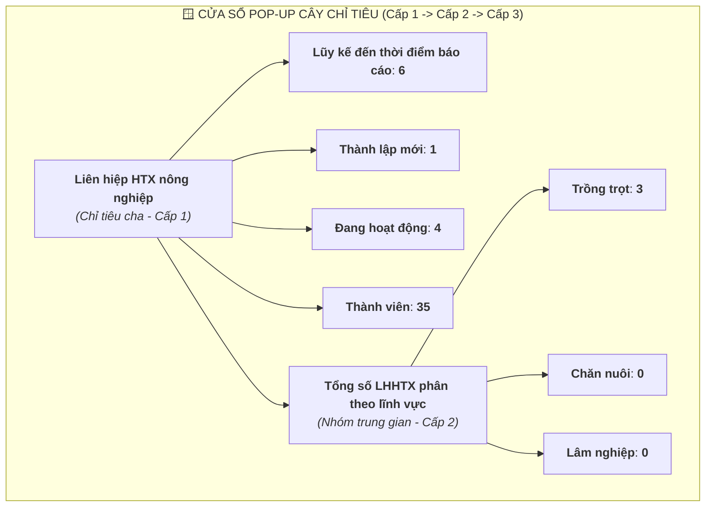

# DANH MỤC CÁC LOẠI CÂU HỎI NGHIỆP VỤ HỆ THỐNG XỬ LÝ

> [!IMPORTANT]
> **Tóm tắt nhanh (30s Overview):** Hệ thống `IPGov_Chatbot` xử lý **4 nhóm câu hỏi nghiệp vụ cốt lõi** trên Kho Dữ Liệu tỉnh Lâm Đồng, đồng thời hỗ trợ đính kèm **🎫 Ticket Thời Gian** (ngày cụ thể, tháng, quý, bán niên, lũy kế) trực tiếp vào từng câu hỏi gốc.

| Mã loại | Nhóm câu hỏi nghiệp vụ hệ thống xử lý | Nhánh con & Ticket đính kèm | Định dạng đầu ra |
| :---: | :--- | :--- | :--- |
| **[`REQ-Q01`](#1-loại-1-req-q01-liệt-kê-danh-sách-các-chỉ-tiêu)** | **Liệt Kê Danh Sách Các Chỉ Tiêu** | • **Nhánh 1.1 (`REQ-Q04`):** Chỉ tiêu Cấp 1 của Nhiệm vụ<br/>• **🎫 Ticket Thời Gian:** Lọc theo Tháng / Quý / Bán niên / Khoảng tháng<br/>• **`SC-1.2` / `SC-4.2`:** Kỳ hoặc nhiệm vụ chưa có dữ liệu duyệt | Bảng 7 cột Cấp 1 + Pop-up Cây chỉ tiêu |
| **[`REQ-Q02`](#2-loại-2-req-q02-tra-cứu-thông-tin-của-một-chỉ-tiêu)** | **Tra Cứu Thông Tin Của Một Chỉ Tiêu** | • **Mặc định:** Chỉ tiêu lá đơn lẻ (có số liệu hoặc chưa có số liệu `'-'`)<br/>• **`SC-2.1`:** Chỉ tiêu lá nằm ở nhiều nhánh cha<br/>• **`SC-2.1b`:** Chỉ tiêu lá định danh kèm nhánh cha (Branch-Scoped Leaf Resolution)<br/>• **`SC-2.4`:** Chỉ tiêu cha (có số liệu hoặc rỗng) + Gợi ý chỉ tiêu con qua action chips duy nhất dưới đáy<br/>• **`SC-2.5`:** Phân cấp & Liệt kê danh mục con (Hierarchy Breakdown — R3)<br/>• **`SC-2.6`:** Phân định Lũy kế vs Trong năm vs Nút lá OCOP (NLU Disambiguation — R4)<br/>• **🎫 Ticket Thời Gian (`slider-time`):** Bộ chọn thời gian tinh gọn 50+, đồng bộ phản ứng 0ms giữa 5 trường và action chips | Thẻ 5 trường + Thanh timeline tinh gọn / Bảng 6 cột / Nút gợi ý chỉ tiêu con duy nhất |
| **[`REQ-Q03`](#3-loại-3-req-q03-liệt-kê-các-nhiệm-vụ-trong-một-lĩnh-vực)** | **Liệt Kê Các Nhiệm Vụ Trong Một Lĩnh Vực** | • **🎫 Ticket Thời Gian:** Lọc nhiệm vụ có báo cáo trong kỳ<br/>• **`SC-3.2`:** Lĩnh vực không tồn tại | Bảng 5 cột + Nút chuyển tiếp xem chỉ tiêu Cấp 1 |
| **[`REQ-Q05`](#4-loại-4-req-q05-kiểm-toán-báo-cáo-biểu-mẫu--phân-công-nhiệm-vụ)** | **Kiểm Toán Báo Cáo, Biểu Mẫu & Phân Công Nhiệm Vụ** | • **`SC-5.1`:** Tiến độ kỳ báo cáo & Đối chiếu bản nháp<br/>• **`SC-5.2`:** Biểu mẫu & Bộ thu thập chỉ tiêu<br/>• **`SC-5.3`:** Ma trận phân công Phòng ban & Cá nhân | Bảng 9 kỳ báo cáo / Bảng 5 bộ thu thập / Ma trận 8 nhiệm vụ |

---

## 1. LOẠI 1 (`REQ-Q01`): Liệt Kê Danh Sách Các Chỉ Tiêu

### A. Câu hỏi mẫu & Tệp chứa Quest
> [!TIP]
> **🎯 Sample Prompts (`REQ-Q01` — Liệt kê danh sách các chỉ tiêu toàn cục / theo đơn vị):**
> - <mark>**"Hệ thống hiện đang thu thập những chỉ tiêu nào trong năm 2026?"**</mark>
> - <mark>**"Liệt kê số lượng các chỉ tiêu từ tháng 2 đến tháng 8 năm nay?"**</mark>
> - <mark>**"Liệt kê số lượng các chỉ tiêu trong tháng 9?"**</mark>
> - <mark>**"Liệt kê danh sách chỉ tiêu của Phòng nông nghiệp trong quý 2 và quý 3?"**</mark>
>
> 📂 **File chứa quest:** [test_output_md_110_perturbations.py (L23-L81)](file:///c:/Users/Admin/HUIT%20-%20H%E1%BB%8Dc%20T%E1%BA%ADp/N%C4%83m%204/Chatbot_Project/IPGov_Chatbot/tests/test_output_md_110_perturbations.py#L23-L81) · [test_req_q01_to_q04_full_spec.py (L11-L56, L285-L307, L455-L490)](file:///c:/Users/Admin/HUIT%20-%20H%E1%BB%8Dc%20T%E1%BA%ADp/N%C4%83m%204/Chatbot_Project/IPGov_Chatbot/tests/test_req_q01_to_q04_full_spec.py#L11-L56) · [test_audit_fixes_subagent2.py (L102-L186)](file:///c:/Users/Admin/HUIT%20-%20H%E1%BB%8Dc%20T%E1%BA%ADp/N%C4%83m%204/Chatbot_Project/IPGov_Chatbot/tests/test_audit_fixes_subagent2.py#L102-L186)

### B. Logic hoạt động
- Truy xuất các bản ghi báo cáo đã phê duyệt và gom về đầu mục chỉ tiêu gốc Cấp 1 trên **Bảng 7 cột**.
- Tách bạch 2 cột độc lập:
  1. **`Giá trị mới nhất`**: Hiển thị giá trị thực tế của chính chỉ tiêu Cấp 1 đó (hoặc `Chưa có số liệu phê duyệt (-)` nếu chỉ tiêu Cấp 1 không có số liệu riêng).
  2. **`Chỉ tiêu con`**: Hiển thị nút **`- (Xem chi tiết con)`** nếu có nhánh con Cấp 2, Cấp 3 hoặc **`Không có`** nếu là chỉ tiêu đơn.

### C. Định dạng câu trả lời (Output mẫu — Bảng 7 Cột)

| STT | Tên chỉ tiêu Cấp 1 | Loại cấu trúc | Giá trị mới nhất | Chỉ tiêu con | Đơn vị thực hiện | Nhiệm vụ trọng tâm |
| :---: | :--- | :--- | :---: | :---: | :--- | :--- |
| 1 | **Tổng hộ sản xuất muối** | Chỉ tiêu đơn *(Cấp 1)* | **660** | Không có | Chi cục | Diêm nghiệp |
| 2 | **Tổng diện tích sản xuất muối** | Nhóm chỉ tiêu *(2 chỉ tiêu con)* | **1.520** | **`- (Xem chi tiết con)`** | Chi cục | Diêm nghiệp |
| 3 | **Liên hiệp HTX nông nghiệp** | Nhóm chỉ tiêu *(8 chỉ tiêu con)* | **Chưa có số liệu phê duyệt (-)** | **`- (Xem chi tiết con)`** | Chi cục | Phát triển nông thôn |
| 4 | **HTX nông nghiệp** | Nhóm chỉ tiêu *(12 chỉ tiêu con)* | **Chưa có số liệu phê duyệt (-)** | **`- (Xem chi tiết con)`** | Chi cục | Phát triển nông thôn |
| 5 | **Trang trại** | Nhóm chỉ tiêu *(9 chỉ tiêu con)* | **Chưa có số liệu phê duyệt (-)** | **`- (Xem chi tiết con)`** | Chi cục | Phát triển nông thôn |

- **Tương tác khi bấm `- (Xem chi tiết con)`:** Mở **Cửa sổ Pop-up** vẽ sơ đồ cây phân cấp từ Cấp 1 $\to$ Cấp 2 $\to$ Cấp 3 kèm số liệu mới nhất trong kỳ:



### D. Các nhánh con & Ticket thời gian của Loại 1

#### 🔹 Nhánh 1.1 (`REQ-Q04`): Hiển thị các chỉ tiêu Cấp 1 của Nhiệm vụ
> [!TIP]
> **🎯 Sample Prompts (`REQ-Q04` — Chỉ tiêu Cấp 1 theo nhiệm vụ):**
> - <mark>**"Hiển thị các chỉ tiêu cấp 1 của nhiệm vụ Phát triển nông thôn?"**</mark>
> - <mark>**"Nhiệm vụ Diêm nghiệp có những chỉ tiêu cấp 1 nào?"**</mark>
> - <mark>**"Danh sách các chỉ tiêu cấp đầu hiện có trong nhiệm vụ phát triển nông thôn là gì?"**</mark>
> - <mark>**"Liệt kê các chỉ tiêu cấp 1 của các nhiệm vụ trọng tâm hiện nay?"**</mark>
>
> 📂 **File chứa quest:** [test_output_md_110_perturbations.py (L250-L303)](file:///c:/Users/Admin/HUIT%20-%20H%E1%BB%8Dc%20T%E1%BA%ADp/N%C4%83m%204/Chatbot_Project/IPGov_Chatbot/tests/test_output_md_110_perturbations.py#L250-L303) · [test_req_q01_to_q04_full_spec.py (L167-L248, L805-L882)](file:///c:/Users/Admin/HUIT%20-%20H%E1%BB%8Dc%20T%E1%BA%ADp/N%C4%83m%204/Chatbot_Project/IPGov_Chatbot/tests/test_req_q01_to_q04_full_spec.py#L167-L248)

- **Output mẫu (Bảng 7 cột theo Nhiệm vụ):**

| STT | Nhiệm vụ | Tên chỉ tiêu Cấp 1 | Loại cấu trúc Cấp 1 | Giá trị mới nhất | Chỉ tiêu con | Đơn vị thực hiện |
| :---: | :--- | :--- | :--- | :---: | :---: | :--- |
| 1 | Diêm nghiệp | **Tổng hộ sản xuất muối** | Chỉ tiêu đơn *(Nút lá Cấp 1)* | **660** | Không có | Chi cục |
| 2 | Diêm nghiệp | **Tổng diện tích sản xuất muối** | Nhóm chỉ tiêu *(2 chỉ tiêu con)* | **1.520** | **`- (Xem chi tiết con)`** | Chi cục |
| 3 | Diêm nghiệp | **Tổng sản lượng muối** | Nhóm chỉ tiêu *(2 chỉ tiêu con)* | **27.000** | **`- (Xem chi tiết con)`** | Chi cục |

#### 🎫 Ticket Thời Gian (`Ticket-Time` cho `REQ-Q01` & `REQ-Q04`): Liệt kê danh sách chỉ tiêu theo khoảng thời gian
> [!TIP]
> **🎫 Sample Prompts khi gắn Ticket Thời Gian vào `REQ-Q01` / `REQ-Q04`:**
> - <mark>**"Từ tháng 4 đến tháng 9 có các chỉ tiêu nào?"**</mark> *(Khoảng tháng)*
> - <mark>**"Trong quý 2 năm nay có những chỉ tiêu nào được thu thập?"**</mark> *(Quý)*
> - <mark>**"Liệt kê số lượng các chỉ tiêu trong nửa đầu năm 2026?"**</mark> *(Bán niên)*
> - <mark>**"Trong quý 3, nhiệm vụ Diêm nghiệp có những chỉ tiêu cấp 1 nào được báo cáo?"**</mark> *(Nhiệm vụ + Quý)*
>
> 📂 **File chứa quest:** [test_output_md_110_perturbations.py (L52-L81, L277-L290)](file:///c:/Users/Admin/HUIT%20-%20H%E1%BB%8Dc%20T%E1%BA%ADp/N%C4%83m%204/Chatbot_Project/IPGov_Chatbot/tests/test_output_md_110_perturbations.py#L52-L81) · [test_req_q01_to_q04_full_spec.py (L11-L56, L805-L863)](file:///c:/Users/Admin/HUIT%20-%20H%E1%BB%8Dc%20T%E1%BA%ADp/N%C4%83m%204/Chatbot_Project/IPGov_Chatbot/tests/test_req_q01_to_q04_full_spec.py#L805-L863)

- **Cơ chế Ticket Thời Gian:**
  - Khi câu hỏi đính kèm mốc/khoảng thời gian (*tháng lẻ*, *từ tháng X đến tháng Y*, *quý 1..4*, *nửa đầu năm*, *nửa cuối năm*, *lũy kế từ đầu năm*), hệ thống lọc các bản ghi đã phê duyệt đúng trong khoảng ngày bắt đầu – kết thúc của kỳ (áp dụng cho cả **Bảng 7 cột** lẫn cây chỉ tiêu trong **Pop-up**).
  - **Trường hợp kỳ hoặc nhiệm vụ chưa phát sinh dữ liệu duyệt (`SC-1.2` / `SC-4.2`):**
    - VD kỳ trống (<mark>*"Các chỉ tiêu thu thập trong tháng 1 năm 2024 là gì?"*</mark>): *"Hiện tại chưa ghi nhận bản ghi chỉ tiêu nào được phê duyệt trong kỳ tháng 01/2024. Đồng chí có thể tra cứu dữ liệu kỳ năm 2026."*
    - VD nhiệm vụ chưa có báo cáo duyệt (<mark>*"Nhiệm vụ Cải cách hành chính năm 2026 có các chỉ tiêu nào?"*</mark>): *"Nhiệm vụ **'Cải cách hành chính'** (do **Phòng kinh tế** phụ trách) hiện đã có trong danh mục nhiệm vụ năm 2026, nhưng **chưa phát sinh bản ghi chỉ tiêu báo cáo nào được phê duyệt** trong hệ thống."*

---

## 2. LOẠI 2 (`REQ-Q02`): Tra Cứu Thông Tin Của Một Chỉ Tiêu

### A. Câu hỏi mẫu & Tệp chứa Quest
> [!TIP]
> **🎯 Sample Prompts (`REQ-Q02` — Chỉ tiêu lá đơn lẻ):**
> - <mark>**"Cho tôi biết tổng hộ sản xuất muối năm 2026 là bao nhiêu?"**</mark>
> - <mark>**"Số lượng sản phẩm OCOP 3 sao đã được công nhận là bao nhiêu?"**</mark>
> - <mark>**"Doanh thu bình quân trong năm của một hợp tác xã nông nghiệp là bao nhiêu?"**</mark>
> - <mark>**"Chỉ tiêu liên kết sản xuất của Tổ hợp tác năm 2026 là bao nhiêu?"**</mark>
>
> 📂 **File chứa quest:** [test_output_md_110_perturbations.py (L85-L119, L169-L185)](file:///c:/Users/Admin/HUIT%20-%20H%E1%BB%8Dc%20T%E1%BA%ADp/N%C4%83m%204/Chatbot_Project/IPGov_Chatbot/tests/test_output_md_110_perturbations.py#L85-L119) · [test_req_q01_to_q04_full_spec.py (L58-L71, L107-L117, L368-L398)](file:///c:/Users/Admin/HUIT%20-%20H%E1%BB%8Dc%20T%E1%BA%ADp/N%C4%83m%204/Chatbot_Project/IPGov_Chatbot/tests/test_req_q01_to_q04_full_spec.py#L58-L71)

### B. Logic hoạt động
- Đối chiếu tên chỉ tiêu trong danh mục:
  1. **Chỉ tiêu lá đơn lẻ:** Lấy bản ghi phê duyệt mới nhất và hiển thị **Thẻ 5 Trường Chuẩn** (nếu giá trị trong kho đang trống hoặc `'-'` thì hiển thị `Chưa có số liệu phê duyệt (-)`).
  2. **Chỉ tiêu lá nằm ở nhiều nhánh cha (`SC-2.1`):** Hiển thị **Bảng 6 cột** đối chiếu toàn bộ các nhánh cha.
  3. **Chỉ tiêu cha (`SC-2.4`):** Nếu chỉ tiêu cha **có số liệu** thì hiển thị **Thẻ 5 Trường Chuẩn** kèm các **Button gợi ý chỉ tiêu con**; nếu chỉ tiêu cha **không có số liệu** thì hiển thị thông báo kèm các **Button gợi ý chỉ tiêu con**.

### C. Định dạng câu trả lời (Output mẫu — Thẻ 5 Trường Chuẩn)

- **Mẫu 1 — Khi chỉ tiêu có số liệu phê duyệt:**
  ```markdown
  Thông tin số liệu mới nhất của chỉ tiêu đồng chí tra cứu:
  - **Chỉ tiêu:** Tổng hộ sản xuất muối *(Chỉ tiêu gốc - Cấp 1)*
  - **Giá trị:** **660**
  - **Đơn vị thực hiện:** Chi cục
  - **Nhiệm vụ trọng tâm:** Diêm nghiệp
  - **Thời điểm báo cáo:** 30/09/2026
  ```
- **Mẫu 2 — Khi chỉ tiêu có trong danh mục nhưng chưa có số liệu trong kỳ (`'-'`):**
  ```markdown
  Thông tin số liệu mới nhất của chỉ tiêu đồng chí tra cứu:
  - **Chỉ tiêu:** Liên kết sản xuất *(Thuộc nhóm: Tổ hợp tác - Cấp 2)*
  - **Giá trị:** Chưa có số liệu phê duyệt (-)
  - **Đơn vị thực hiện:** Chi cục
  - **Nhiệm vụ trọng tâm:** Phát triển nông thôn
  - **Thời điểm báo cáo:** 30/09/2026
  ```

### D. Các nhánh con & Ticket thời gian của Loại 2

#### 🔹 `SC-2.1`: Chỉ tiêu lá nằm ở nhiều nhánh chỉ tiêu cha khác nhau
> [!TIP]
> **🎯 Sample Prompts (`SC-2.1` — Các chỉ tiêu lá xuất hiện ở nhiều nhánh cha *HTX*, *LHHTX*, *Tổ hợp tác*, *Trang trại*):**
> - <mark>**"Chỉ tiêu thành lập mới hiện tại là bao nhiêu?"**</mark>
> - <mark>**"Cho tôi xem số liệu chỉ tiêu đang hoạt động?"**</mark>
> - <mark>**"Chỉ tiêu trồng trọt hiện đạt bao nhiêu?"**</mark>
> - <mark>**"Số lượng chỉ tiêu trồng trọt ngày 30/4?"**</mark> *(Kết hợp `🎫 Ticket thời gian`)*
>
> 📂 **File chứa quest:** [test_output_md_110_perturbations.py (L120-L138)](file:///c:/Users/Admin/HUIT%20-%20H%E1%BB%8Dc%20T%E1%BA%ADp/N%C4%83m%204/Chatbot_Project/IPGov_Chatbot/tests/test_output_md_110_perturbations.py#L120-L138) · [test_req_q01_to_q04_full_spec.py (L73-L89, L341-L366)](file:///c:/Users/Admin/HUIT%20-%20H%E1%BB%8Dc%20T%E1%BA%ADp/N%C4%83m%204/Chatbot_Project/IPGov_Chatbot/tests/test_req_q01_to_q04_full_spec.py#L341-L366)

- **Output mẫu (Bảng 6 cột đối chiếu toàn bộ các nhánh cha):**

| STT | Tên chỉ tiêu | Nhóm chỉ tiêu (Cấp) | Giá trị mới nhất | Đơn vị thực hiện | Nhiệm vụ trọng tâm |
| :---: | :--- | :--- | :---: | :--- | :--- |
| 1 | Trồng trọt | HTX nông nghiệp > Số lượng HTX phân theo lĩnh vực *(Cấp 2)* | **26** | Chi cục | Phát triển nông thôn |
| 2 | Trồng trọt | Liên hiệp HTX nông nghiệp > Tổng số LHHTX phân theo lĩnh vực *(Cấp 2)* | **3** | Chi cục | Phát triển nông thôn |
| 3 | Trồng trọt | Tổ hợp tác nông nghiệp > Tổng số THT phân theo lĩnh vực *(Cấp 2)* | **12** | Chi cục | Phát triển nông thôn |
| 4 | Trồng trọt | Trang trại > Tổng số trang trại *(Cấp 2)* | **16** | Chi cục | Phát triển nông thôn |

#### 🔹 `SC-2.1b`: Chỉ tiêu lá nằm ở nhiều nhánh cha nhưng câu hỏi đã nêu rõ thực thể / nhánh cha (Branch-Scoped Single Criterion)
> [!TIP]
> **🎯 Sample Prompts (`SC-2.1b` — Định danh trực tiếp chỉ tiêu con khi người dùng chỉ rõ nhánh cha):**
> - <mark>**"cho tôi biết số liệu chăn nuôi của liên hiệp hợp tác xã ngày 30/4"**</mark> *(Định danh nhánh Liên hiệp HTX)*
> - <mark>**"chăn nuôi của hợp tác xã nông nghiệp"**</mark> *(Định danh nhánh HTX)*
> - <mark>**"số liệu trồng trọt của tổ hợp tác nông nghiệp"**</mark> *(Định danh nhánh THT)*
> - <mark>**"thông tin chăn nuôi của trang trại"**</mark> *(Định danh nhánh Trang trại)*

- **Logic hoạt động:**
  Khi câu hỏi chứa tên của chỉ tiêu lá (như *Chăn nuôi*, *Trồng trọt*) đồng thời chứa tên của thực thể/nhánh cha (như *Liên hiệp HTX*, *Hợp tác xã*, *Tổ hợp tác*, *Trang trại*), hệ thống thực hiện chuẩn hóa từ viết tắt hai chiều (`liên hiệp hợp tác xã` / `liên hiệp htx` $\leftrightarrow$ `lhhtx`, `hợp tác xã` $\leftrightarrow$ `htx`, `tổ hợp tác` $\leftrightarrow$ `tht`, `trang trại` $\leftrightarrow$ `tt`) để phân giải trực tiếp và tất định về đúng chỉ tiêu lá thuộc nhánh cha được chỉ định.
- **Output mẫu (Thẻ 5 Trường Chuẩn — Bỏ qua bảng đối chiếu 4 nhánh cha):**
  Hệ thống xuất trực tiếp **Thẻ 5 Trường Chuẩn** (kèm mốc thời gian đối chiếu gần nhất nếu có ngày cụ thể) thay vì hiển thị bảng so sánh 4 nhánh:
  ```markdown
  Thông tin số liệu mới nhất của chỉ tiêu đồng chí tra cứu:
  - **Chỉ tiêu:** Chăn nuôi *(Thuộc nhóm: Tổng số LHHTX phân theo lĩnh vực - Cấp 2)*
  - **Giá trị:** **1**
  - **Đơn vị thực hiện:** Chi cục
  - **Nhiệm vụ trọng tâm:** Phát triển nông thôn
  - **Thời điểm báo cáo:** 31/03/2026 *(Lưu ý mốc thời gian: Dữ liệu được đối chiếu tại kỳ báo cáo gần nhất ngày 31/03/2026, lệch 30 ngày so với ngày yêu cầu 30/04/2026)*
  ```

#### 🔹 `SC-2.4`: Hỏi vào tên một chỉ tiêu cha (có các chỉ tiêu con bên dưới)
> [!TIP]
> **🎯 Sample Prompts (`SC-2.4`):**
> - <mark>**"Tổng số lượng chủ thể sản phẩm OCOP trong năm là bao nhiêu?"**</mark> *(Chỉ tiêu cha **có số liệu**)*
> - <mark>**"Cho tôi biết số liệu chỉ tiêu Liên hiệp HTX nông nghiệp?"**</mark> *(Chỉ tiêu cha **không có số liệu**)*
> - <mark>**"Thông tin số liệu Chương trình OCOP hiện tại là bao nhiêu?"**</mark> *(Chỉ tiêu cha **không có số liệu**)*
> - <mark>**"Số liệu chỉ tiêu trang trại ngày 23/4 là bao nhiêu?"**</mark> *(Chỉ tiêu cha kết hợp `🎫 Ticket thời gian`)*
>
> 📂 **File chứa quest:** [test_output_md_110_perturbations.py (L140-L167, L187-L198)](file:///c:/Users/Admin/HUIT%20-%20H%E1%BB%8Dc%20T%E1%BA%ADp/N%C4%83m%204/Chatbot_Project/IPGov_Chatbot/tests/test_output_md_110_perturbations.py#L187-L198) · [test_req_q01_to_q04_full_spec.py (L119-L136, L308-L339)](file:///c:/Users/Admin/HUIT%20-%20H%E1%BB%8Dc%20T%E1%BA%ADp/N%C4%83m%204/Chatbot_Project/IPGov_Chatbot/tests/test_req_q01_to_q04_full_spec.py#L308-L339) · [test_srs_v3_upgrades.py (L145-L191)](file:///c:/Users/Admin/HUIT%20-%20H%E1%BB%8Dc%20T%E1%BA%ADp/N%C4%83m%204/Chatbot_Project/IPGov_Chatbot/tests/test_srs_v3_upgrades.py#L145-L191)

- **Trường hợp 1 (`SC-2.4a`) — Chỉ tiêu cha CÓ số liệu tổng hợp (VD: `'Tổng số lượng chủ thể sản phẩm OCOP trong năm'` có giá trị `17` tại kỳ `30/09/2026`):**
  - Hiển thị **Thẻ 5 Trường Chuẩn** của chỉ tiêu cha kèm các **Nút gợi ý chỉ tiêu con tương tác** (`quick_action_chips`) ở đáy:
  ```markdown
  Thông tin số liệu mới nhất của chỉ tiêu đồng chí tra cứu:
  - **Chỉ tiêu:** Tổng số lượng chủ thể sản phẩm OCOP trong năm *(Thuộc nhóm: Chương trình OCOP - Cấp 2)*
  - **Giá trị:** **17**
  - **Đơn vị thực hiện:** Chi cục
  - **Nhiệm vụ trọng tâm:** Phát triển nông thôn
  - **Thời điểm báo cáo:** 30/09/2026

  Đồng chí có thể bấm chọn một trong các **chỉ tiêu con trực thuộc** ở bên dưới để xem chi tiết.
  ```
  > [!NOTE]
  > **Quy tắc hiển thị nút chỉ tiêu con duy nhất:** Các nút gợi ý chỉ tiêu con xuất hiện **duy nhất 1 lần** dưới dạng các action chips tương tác (`quick_action_chips`) đặt ở đáy tin nhắn. Tuyệt đối không chèn lặp danh sách text inline `🔘 [...]` vào cuối đoạn văn bản markdown.

- **Trường hợp 2 (`SC-2.4b`) — Chỉ tiêu cha KHÔNG có số liệu tổng hợp (VD: `'Liên hiệp HTX nông nghiệp'`):**
  > *"Chỉ tiêu **'Liên hiệp HTX nông nghiệp'** là một **chỉ tiêu cha (nhóm chỉ tiêu)** nên không có số liệu tổng hợp riêng lẻ. Đồng chí vui lòng bấm chọn một trong các **chỉ tiêu con đang có số liệu** trực thuộc nhóm này ở bên dưới để xem chi tiết."*
  >
  > *(Các nút gợi ý chỉ tiêu con hiển thị duy nhất dạng interactive action chips ở đáy tin nhắn, không nhân bản text inline `🔘 [...]` trong văn bản).*

#### 🎫 Ticket Thời Gian (`slider-time` / `Ticket-Time` cho toàn bộ `REQ-Q02`): Lọc số liệu theo ngày cụ thể, khoảng thời gian hoặc bộ chọn mốc thời gian tinh gọn
> [!TIP]
> **🎫 Sample Prompts khi gắn Ticket Thời Gian (`slider-time`) vào Chỉ tiêu lá đơn lẻ / Chỉ tiêu lá đa nhánh (`SC-2.1`) / Chỉ tiêu cha (`SC-2.4`):**
> - <mark>**"Cho tôi biết số liệu chỉ tiêu tổng hộ sản xuất muối vào ngày 30/9?"**</mark> *(Chỉ tiêu lá đơn lẻ + Ngày)*
> - <mark>**"Chỉ tiêu sản lượng muối công nghiệp trong quý 2 năm 2026 là bao nhiêu?"**</mark> *(Chỉ tiêu lá đơn lẻ + Quý)*
> - <mark>**"Số lượng chỉ tiêu trồng trọt ngày 30/4?"**</mark> *(Chỉ tiêu lá đa nhánh `SC-2.1` + Ngày)*
> - <mark>**"Số liệu chỉ tiêu trang trại ngày 23/4 là bao nhiêu?"**</mark> *(Chỉ tiêu cha `SC-2.4` + Ngày)*
> - <mark>**"Tổng diện tích sản xuất muối trong nửa đầu năm 2026 là bao nhiêu?"**</mark> *(Chỉ tiêu cha `SC-2.4` + Khoảng thời gian)*
>
> 📂 **File chứa quest:** [test_output_md_110_perturbations.py (L140-L167)](file:///c:/Users/Admin/HUIT%20-%20H%E1%BB%8Dc%20T%E1%BA%ADp/N%C4%83m%204/Chatbot_Project/IPGov_Chatbot/tests/test_output_md_110_perturbations.py#L140-L167) · [test_req_q01_to_q04_full_spec.py (L91-L105, L684-L722)](file:///c:/Users/Admin/HUIT%20-%20H%E1%BB%8Dc%20T%E1%BA%ADp/N%C4%83m%204/Chatbot_Project/IPGov_Chatbot/tests/test_req_q01_to_q04_full_spec.py#L684-L722) · [test_srs_v3_upgrades.py (L80-L140)](file:///c:/Users/Admin/HUIT%20-%20H%E1%BB%8Dc%20T%E1%BA%ADp/N%C4%83m%204/Chatbot_Project/IPGov_Chatbot/tests/test_srs_v3_upgrades.py#L80-L140)

- **Cơ chế Ticket Thời Gian (`slider-time`) trên `REQ-Q02` (Áp dụng đồng nhất cho cả Chỉ tiêu lá đơn lẻ, `SC-2.1` và `SC-2.4`):**
  1. **Khi gắn mốc ngày cụ thể $a$ (trên dãy mốc báo cáo $D = [A, B, C, \dots]$):** Xác định khoảng $[A, B]$ chứa $a$, so sánh khoảng cách $\Delta_A = a - A$ và $\Delta_B = B - a$ để chọn kỳ báo cáo gần nhất (nếu $\Delta_A = \Delta_B$ thì ưu tiên cận trên $B$). *Ví dụ:* các mốc `[31/03, 30/06, 30/09]`, hỏi ngày `30/04` hoặc `23/04` $\to$ đối chiếu về kỳ báo cáo gần nhất ngày **`31/03/2026`** và thông báo rõ ngày đối chiếu.
  2. **Khi gắn khoảng thời gian (tháng, quý, nửa đầu năm, lũy kế...):** Lấy bản ghi tại kỳ báo cáo mới nhất nằm trong khoảng thời gian đó.
  3. **Bộ chọn mốc thời gian tinh gọn tối ưu cho cán bộ cao tuổi (Senior-Friendly Unified Timeline Selector & Đồng bộ phản ứng 0ms):**
     - Loại bỏ hoàn toàn khối 3 hộp rời rạc rườm rà phía trên (`Số liệu phê duyệt`, `Đơn vị thực hiện`, `Nhiệm vụ / Biểu mẫu`) và các nhãn dev kỹ thuật (`Ticket slider-time • 0ms`) gây phân tán thị giác cho người dùng từ 50 tuổi trở lên.
     - Tái cấu trúc thành **Thanh điều khiển kỳ báo cáo đồng nhất** tích hợp liền khối ngay trên danh sách 5 trường chuẩn (`Chỉ tiêu`, `Giá trị`, `Đơn vị thực hiện`, `Nhiệm vụ trọng tâm`, `Thời điểm báo cáo`), thiết kế nút bấm kỳ lớn (`px-3 py-1.5`, `font-bold`), tương phản cao, ô nhập ngày tùy chỉnh và nút Ghim (`📌`).
     - **Đồng bộ phản ứng tức thì (`0ms Reactive State Synchronization`):** Khi người dùng bấm chuyển đổi giữa các mốc báo cáo (`31/03/2026`, `30/06/2026`, `30/09/2026`, hoặc ngày tùy chỉnh), hệ thống cập nhật đồng thời trong `0ms` ở phía Client:
       * Giá trị `- **Giá trị:**` và `- **Thời điểm báo cáo:**` (kèm lưu ý lệch ngày nếu có) trong khối văn bản 5 trường chi tiết.
       * Huy hiệu số liệu xem trước (`preview_value` badge) trên **tất cả các nút gợi ý chỉ tiêu con** (`quick_action_chips`) ở đáy tin nhắn.

#### 🔹 `SC-2.5`: Truy Vấn Phân Cấp & Liệt Kê Danh Mục Con Trực Thuộc (Hierarchy Breakdown & Enumeration Queries — R3)
> [!TIP]
> **🎯 Sample Prompts (`SC-2.5` — Liệt kê/đếm các lĩnh vực, phân nhóm, mức đánh giá con của một thực thể trong DWH):**
> - <mark>**"bạn hãy cho tôi biết số lĩnh vực của HTX"**</mark> *(8 lĩnh vực của Hợp tác xã)*
> - <mark>**"Bạn hãy cho tôi biết các mức đánh giá hiệu quả hoạt động của hợp tác xã"**</mark> *(4 mức đánh giá hiệu quả HTX)*
> - <mark>**"Cho tôi biết đang có các loại diện tích sản xuất muối gì?"**</mark> *(2 loại diện tích làm muối)*
> - <mark>**"Liệt kê các lĩnh vực hoạt động của tổ hợp tác nông nghiệp"**</mark> *(8 lĩnh vực của THT)*
> - <mark>**"Cho biết các mức xếp loại hiệu quả của tổ hợp tác"**</mark> *(3 mức xếp loại THT)*
> - <mark>**"Liên hiệp HTX nông nghiệp gồm những lĩnh vực nào?"**</mark> *(8 lĩnh vực của LHHTX)*
> - <mark>**"Trang trại nông nghiệp phân theo những lĩnh vực gì?"**</mark> *(7 lĩnh vực của Trang trại)*
> - <mark>**"Hiện có những loại sản lượng muối nào được thống kê?"**</mark> *(2 loại sản lượng muối)*

- **Logic hoạt động (Warehouse-Grounded NLU Reasoning — Zero Regex / Zero Heuristics):**
  1. **Nhận diện Ý định Liệt kê Danh mục Phân cấp:** Phân biệt chính xác giữa câu hỏi tra cứu giá trị số đo tổng hợp đơn lẻ (`METRIC_POINT_INQUIRY`) với câu hỏi hỏi về **số lượng và danh sách các phân nhóm / cấp bậc / loại hình / lĩnh vực** con tồn tại dưới một thực thể trong kho dữ liệu (`DIMENSION_LISTING` với cờ `is_hierarchical_breakdown=True`).
  2. **Neo Thực thể Gốc & Phân giải Nhóm Cha (Entity Root Anchoring & Aspect Cues):**
     - Trích xuất thực thể gốc để neo ngữ cảnh nhánh cây: `'HTX nông nghiệp'`, `'Tổ hợp tác nông nghiệp'`, `'Liên hiệp HTX nông nghiệp'`, `'Trang trại'`, `'Diêm nghiệp'`, `'Chương trình OCOP'`.
     - Sử dụng chỉ dấu ngữ nghĩa (aspect cues: *lĩnh vực*, *hiệu quả*, *diện tích*, *sản lượng*...) để định vị chính xác nhóm cha trung gian trong nhánh đã neo (tránh nhầm lẫn giữa `'Hiệu quả hoạt động'` của HTX với THT hay Trang trại).
  3. **Truy xuất Danh mục & Dữ liệu Thực thi từ Kho DWH:**
     - Truy vấn các nút con trực thuộc từ `catalog_criteria_hierarchy` (`WHERE parent_id = matched_parent.id`).
     - Kết nối dữ liệu báo cáo phê duyệt mới nhất từ `fact_report_criteria` theo tỉnh (`tenant_code`) và năm (`year_code`).
  4. **Cấm tuyệt đối Anti-Pattern Heuristic:** Nghiêm cấm dùng danh sách từ khóa cố định, so khớp chuỗi regex hoặc chuỗi `if/else` để hardcode danh sách lĩnh vực hay số lượng.

- **Định dạng câu trả lời (Output mẫu — Câu dẫn số lượng + Tên in đậm + Bảng 6 Cột Đầy Đủ):**
  - **Câu dẫn tự nhiên:** Nêu rõ số lượng chính xác tìm thấy trong kho DWH và liệt kê tên in đậm của tất cả các phân nhóm/chỉ tiêu con.
    > *"Trong kho dữ liệu DWH tỉnh Lâm Đồng, hiện có **8** phân nhóm/chỉ tiêu con trực thuộc nhóm **'Số lượng HTX phân theo lĩnh vực'** (thuộc **HTX nông nghiệp**) gồm: **Trồng trọt**, **Chăn nuôi**, **Lâm nghiệp**, **Thủy sản**, **Diêm nghiệp**, **Chế biến nông sản**, **Nước sạch NT**, **Tổng hợp**:"*
  - **Bảng 6 Cột Đầy Đủ Thông Tin:**

| STT | Tên chỉ tiêu | Nhóm chỉ tiêu | Giá trị mới nhất | Đơn vị thực hiện | Nhiệm vụ trọng tâm |
| :---: | :--- | :--- | :---: | :--- | :--- |
| 1 | **Trồng trọt** | Số lượng HTX phân theo lĩnh vực *(Cấp 2)* | **26** | Chi cục | Phát triển nông thôn |
| 2 | **Chăn nuôi** | Số lượng HTX phân theo lĩnh vực *(Cấp 2)* | **64** | Chi cục | Phát triển nông thôn |
| 3 | **Lâm nghiệp** | Số lượng HTX phân theo lĩnh vực *(Cấp 2)* | **0** | Chi cục | Phát triển nông thôn |
| 4 | **Thủy sản** | Số lượng HTX phân theo lĩnh vực *(Cấp 2)* | **2** | Chi cục | Phát triển nông thôn |
| 5 | **Diêm nghiệp** | Số lượng HTX phân theo lĩnh vực *(Cấp 2)* | **0** | Chi cục | Phát triển nông thôn |
| 6 | **Chế biến nông sản** | Số lượng HTX phân theo lĩnh vực *(Cấp 2)* | **0** | Chi cục | Phát triển nông thôn |
| 7 | **Nước sạch NT** | Số lượng HTX phân theo lĩnh vực *(Cấp 2)* | **1** | Chi cục | Phát triển nông thôn |
| 8 | **Tổng hợp** | Số lượng HTX phân theo lĩnh vực *(Cấp 2)* | **45** | Chi cục | Phát triển nông thôn |

  - **Cấu trúc DTO kèm theo:** Trả về `tabular_data` chuẩn hóa (6 cột) và mảng `quick_action_chips` chứa các nút con để người dùng bấm tra cứu sâu hơn (chỉ hiển thị ở đáy, không nhân bản text inline).

#### 🔹 `SC-2.6`: Phân Định Ngữ Nghĩa Chỉ Tiêu Lũy Kế vs Trong Năm vs Nút Lá OCOP (Cumulative vs Annual vs Leaf Disambiguation — R4)
> [!TIP]
> **🎯 Sample Prompts (`SC-2.6` — Phân định rõ chỉ tiêu lũy kế với chỉ tiêu trong năm hoặc các hạng sao OCOP lá con):**
> - <mark>**"bạn hãy cho tôi biết lũy kế tổng số lượng chủ thể sản phẩm theo dữ liệu mới nhất"**</mark> *(Phân giải về `Lũy kế  tổng số lượng chủ thể đến thời điểm báo cáo`)*
> - <mark>**"bạn hãy cho tôi biết lũy kế tổng số lượng chủ thể sản phẩm OCOP theo dữ liệu mới nhất"**</mark> *(Phân giải về `Lũy kế  tổng số lượng sản phẩm OCOP đến thời điểm báo cáo`)*
> - <mark>**"Tổng số lượng chủ thể OCOP lũy kế đến thời điểm báo cáo là bao nhiêu?"**</mark>
> - <mark>**"Số lượng sản phẩm OCOP lũy kế đến thời điểm báo cáo là bao nhiêu?"**</mark>

- **Logic hoạt động (Semantic Scoring & Candidate Pool Sizing — Khắc phục Bẫy Token Overlap):**
  1. **Thách thức:** Các chỉ tiêu OCOP chia sẻ mật độ từ khóa rất cao (*chủ thể*, *sản phẩm*, *OCOP*, *tổng số lượng*), dễ khiến cơ chế so khớp token mờ truyền thống xếp nhầm các nút lá con (`Số lượng chủ thể sản phẩm OCOP 5 sao`) hoặc nhóm hàng năm (`Tổng số lượng chủ thể sản phẩm OCOP trong năm`) lên vị trí đầu.
  2. **Mở rộng Kích thước Tập Ứng viên (Candidate Pool Sizing):** Thiết lập `candidate_pool_size = max(top_k * 5, 25)` trong bước truy hồi DuckDB Catalog (`find_criteria_by_name`), ngăn chặn việc cắt tỉa ứng viên quá sớm trước khi chuyển sang bộ xếp hạng tinh (reranker). Các chỉ tiêu có khoảng trắng đôi trong CSDL (`"Lũy kế  tổng số lượng..."`) được bảo toàn trọn vẹn trong pool.
  3. **Chấm điểm Phân cực Thời gian (Temporal Polarity Scoring):**
     - Khi câu hỏi mang tín hiệu lũy kế (*lũy kế*, *đến thời điểm báo cáo*): Ứng viên lũy kế nhận điểm thưởng $\Delta_{\text{temporal}} = +25.0$; ứng viên hàng năm (*trong năm*) nhận điểm phạt $\Delta_{\text{temporal}} = -30.0$.
     - Khi câu hỏi mang tín hiệu hàng năm (*trong năm*): Ứng viên hàng năm nhận $+25.0$; ứng viên lũy kế nhận $-30.0$.
  4. **Phạt Tính Đặc thù Xếp hạng Sao OCOP (Star Rating Specificity Penalty):**
     - Khi câu hỏi của người dùng **KHÔNG** yêu cầu tường minh thứ hạng sao (*"3 sao"*, *"4 sao"*, *"5 sao"*), tất cả các chỉ tiêu lá con mang xếp hạng sao đều nhận điểm phạt $\Delta_{\text{star}} = -25.0$. Cơ chế này ngăn chặn việc nhóm chỉ tiêu tổng quát bị nuốt nhầm vào một nút lá 5 sao.
  5. **Phân cực Đối tượng Thực thể (Entity Subject vs Product Polarity):**
     - Khi câu hỏi hỏi về *chủ thể* mà không hỏi riêng *sản phẩm*: Ứng viên chứa từ khóa *chủ thể* nhận $+15.0$, ứng viên chỉ chứa *sản phẩm* nhận $-15.0$.
  6. **Kết quả Đầu ra:** Hệ thống giải quyết chính xác về nhóm chỉ tiêu cha lũy kế tương ứng (`Lũy kế  tổng số lượng chủ thể đến thời điểm báo cáo` hoặc `Lũy kế  tổng số lượng sản phẩm OCOP đến thời điểm báo cáo`), xuất Thẻ 5 trường chuẩn kèm các nút gợi ý chỉ tiêu con tương tác ở đáy (`quick_action_chips`).

---

## 3. LOẠI 3 (`REQ-Q03`): Liệt Kê Các Nhiệm Vụ Trong Một Lĩnh Vực

### A. Câu hỏi mẫu & Tệp chứa Quest
> [!TIP]
> **🎯 Sample Prompts (`REQ-Q03` — Liệt kê nhiệm vụ theo lĩnh vực):**
> - <mark>**"Liệt kê các nhiệm vụ trong lĩnh vực Nông nghiệp?"**</mark>
> - <mark>**"Lĩnh vực Nông nghiệp hiện có những nhiệm vụ trọng tâm nào?"**</mark>
> - <mark>**"Cho tôi danh sách tên các nhiệm vụ thuộc lĩnh vực 1?"**</mark>
>
> 📂 **File chứa quest:** [test_output_md_110_perturbations.py (L202-L246)](file:///c:/Users/Admin/HUIT%20-%20H%E1%BB%8Dc%20T%E1%BA%ADp/N%C4%83m%204/Chatbot_Project/IPGov_Chatbot/tests/test_output_md_110_perturbations.py#L202-L246) · [test_req_q01_to_q04_full_spec.py (L138-L165, L248-L267, L732-L803)](file:///c:/Users/Admin/HUIT%20-%20H%E1%BB%8Dc%20T%E1%BA%ADp/N%C4%83m%204/Chatbot_Project/IPGov_Chatbot/tests/test_req_q01_to_q04_full_spec.py#L732-L803)

### B. Logic hoạt động & Định dạng câu trả lời (Bảng 5 Cột)
- Lọc các nhiệm vụ thuộc lĩnh vực được hỏi kèm đơn vị phụ trách và hỗ trợ nút **`🔍 Xem chỉ tiêu Cấp 1`** trên từng dòng để chuyển tiếp sang Nhánh 1.1 (`REQ-Q04`).

| STT | Mã nhiệm vụ | Tên nhiệm vụ | Lĩnh vực | Đơn vị phụ trách |
| :---: | :--- | :--- | :--- | :--- |
| 1 | `NV_DN_01` | **Diêm nghiệp** | Nông nghiệp | Chi cục |
| 2 | `NV_PTNT_02` | **Phát triển nông thôn** | Nông nghiệp | Chi cục |

### C. Ticket Thời Gian & Trường hợp đặc biệt của Loại 3

- **🎫 Ticket Thời Gian (`SC-3.1` — Lọc nhiệm vụ thuộc lĩnh vực theo khoảng thời gian):**
  - **Sample Prompts:** <mark>**"Lĩnh vực Nông nghiệp trong nửa đầu năm có những nhiệm vụ nào?"**</mark>, <mark>**"Từ tháng 2 đến tháng 9 lĩnh vực Nông nghiệp có những nhiệm vụ nào?"**</mark>
  - **Logic:** Chỉ liệt kê các nhiệm vụ thuộc lĩnh vực có phát sinh báo cáo phê duyệt trong khoảng thời gian được hỏi và bảo toàn ngữ cảnh thời gian khi chuyển tiếp sang xem chỉ tiêu Cấp 1.
- **🔹 `SC-3.2` — Tên lĩnh vực không tồn tại trong hệ thống:**
  - **Sample Prompts:** <mark>**"Liệt kê các nhiệm vụ thuộc lĩnh vực Hàng không vũ trụ?"**</mark>
  - **Output mẫu:**
    > *"Hiện tại trong kho dữ liệu tỉnh Lâm Đồng **không có lĩnh vực 'Hàng không vũ trụ'**. Đồng chí có thể tra cứu các nhiệm vụ thuộc các lĩnh vực hiện có sau đây:"*
    >
    > 🔘 `[Lĩnh vực: Nông nghiệp]` &nbsp; 🔘 `[Lĩnh vực: Lĩnh vực 1]`

---

## 4. LOẠI 4 (`REQ-Q05`): Kiểm Toán Báo Cáo, Biểu Mẫu & Phân Công Nhiệm Vụ

### 🔹 `SC-5.1`: Kiểm toán tiến độ kỳ báo cáo & Đối chiếu số liệu bản nháp (`SC-5.1a` & `SC-5.1b`)
> [!TIP]
> **🎯 Sample Prompts (`SC-5.1`):**
> - <mark>**"Liệt kê trạng thái các kỳ báo cáo năm 2026, ngày nộp và những báo cáo nào đang ở trạng thái nháp chưa nộp?"**</mark> *(`SC-5.1a`)*
> - <mark>**"Cho biết chi tiết các chỉ tiêu trong các kỳ báo cáo nháp của nhiệm vụ Diêm nghiệp năm 2026 và đối chiếu chênh lệch với bản đã phê duyệt?"**</mark> *(`SC-5.1b`)*
>
> 📂 **File chứa quest:** [test_output_md_110_perturbations.py (L308-L334)](file:///c:/Users/Admin/HUIT%20-%20H%E1%BB%8Dc%20T%E1%BA%ADp/N%C4%83m%204/Chatbot_Project/IPGov_Chatbot/tests/test_output_md_110_perturbations.py#L308-L334) · [test_req_q05_report_form_mission_audit.py (L46-L83)](file:///c:/Users/Admin/HUIT%20-%20H%E1%BB%8Dc%20T%E1%BA%ADp/N%C4%83m%204/Chatbot_Project/IPGov_Chatbot/tests/test_req_q05_report_form_mission_audit.py#L46-L83)

- **Output mẫu `SC-5.1a` (Bảng 9 kỳ báo cáo năm 2026 — câu dẫn ngắn gọn, thuần Việt):**
  > *"Tổng hợp tiến độ 9 kỳ báo cáo năm 2026 của tỉnh Lâm Đồng (6 kỳ đã phê duyệt, 3 kỳ bản nháp chưa nộp):"*

| STT | Kỳ báo cáo | Ngày nộp | Trạng thái | Người tạo | Đơn vị thực hiện | Nhiệm vụ báo cáo | Tổng chỉ tiêu | Chỉ tiêu đã có số liệu |
| :---: | :---: | :---: | :--- | :---: | :--- | :--- | :---: | :---: |
| 1 | **2026-09-30** | `2026-03-26` | Đã phê duyệt | `tzyalnh` | Chi cục | Phát triển nông thôn | 107 | **37** |
| 2 | **2026-09-20** | `2026-03-26` | Đã phê duyệt | `tzyalnh` | Chi cục | Diêm nghiệp | 7 | **6** |
| 3 | **2026-06-30** | `2026-03-26` | Đã phê duyệt | `tzyalnh` | Chi cục | Diêm nghiệp | 7 | **4** |
| 4 | **2026-06-30** | `2026-03-26` | Đã phê duyệt | `tzyalnh` | Chi cục | Phát triển nông thôn | 107 | **21** |
| 5 | **2026-03-31** | `2026-03-26` | Đã phê duyệt | `tzyalnh` | Chi cục | Diêm nghiệp | 7 | **7** |
| 6 | **2026-03-31** | `2026-03-26` | Đã phê duyệt | `tzyalnh` | Chi cục | Phát triển nông thôn | 107 | **46** |
| 7 | **2026-09-22** | `Chưa nộp (-)` | Bản nháp | `tzyalnh` | Chi cục | Diêm nghiệp | 7 | **4** |
| 8 | **2026-09-21** | `Chưa nộp (-)` | Bản nháp | `tzyalnh` | Chi cục | Phát triển nông thôn | 107 | **37** |
| 9 | **2026-08-31** | `Chưa nộp (-)` | Bản nháp | `tzyalnh` | Chi cục | Diêm nghiệp | 7 | **7** |

- **Output mẫu `SC-5.1b` (Chi tiết 2 kỳ báo cáo nháp của nhiệm vụ `Diêm nghiệp`):**
  - **Kỳ nháp `2026-09-22` (7 dòng):** `Tổng diện tích sản xuất muối` = **`52`**, `Diện tích muối sản xuất công nghiệp` = **`12`**, `Diện tích muối sản xuất thủ công` = **`64`**, `Tổng sản lượng muối` = **`0`**, 3 chỉ tiêu còn lại chưa có số liệu (**`Chưa nhập (-)`**).
  - **Kỳ nháp `2026-08-31` (7 dòng):** `Tổng diện tích sản xuất muối` = **`1.800`**, `Diện tích muối sản xuất công nghiệp` = **`500`**, `Diện tích muối sản xuất thủ công` = **`700`**, `Tổng sản lượng muối` = **`2.500`**, `Sản lượng muối công nghiệp` = **`550`**, `Sản lượng muối thủ công` = **`420`**, `Tổng hộ sản xuất muối` = **`50`**.

---

### 🔹 `SC-5.2`: Kiểm toán biểu mẫu thu thập & Bộ thu thập chỉ tiêu (`SC-5.2a` & `SC-5.2b`)
> [!TIP]
> **🎯 Sample Prompts (`SC-5.2`):**
> - <mark>**"Hệ thống hiện có những biểu mẫu thu thập hoặc bộ thu thập chỉ tiêu nào đang áp dụng năm 2026?"**</mark>
> - <mark>**"Năm 2026 đang áp dụng những biểu mẫu thu thập hoặc bộ thu thập chỉ tiêu nào trên hệ thống?"**</mark>
>
> 📂 **File chứa quest:** [test_output_md_110_perturbations.py (L336-L348)](file:///c:/Users/Admin/HUIT%20-%20H%E1%BB%8Dc%20T%E1%BA%ADp/N%C4%83m%204/Chatbot_Project/IPGov_Chatbot/tests/test_output_md_110_perturbations.py#L336-L348) · [test_req_q05_report_form_mission_audit.py (L84-L102)](file:///c:/Users/Admin/HUIT%20-%20H%E1%BB%8Dc%20T%E1%BA%ADp/N%C4%83m%204/Chatbot_Project/IPGov_Chatbot/tests/test_req_q05_report_form_mission_audit.py#L84-L102)

- **Output mẫu (Bảng 5 bộ thu thập chỉ tiêu năm 2026):**
  > *"Hệ thống hiện ghi nhận 0 biểu mẫu thu thập độc lập và 5 bộ thu thập chỉ tiêu năm 2026 (3 bộ đang kích hoạt, 2 bộ bản nháp):"*

| STT | Tên bộ thu thập | Trạng thái | Người tạo | Nhiệm vụ liên kết | Lĩnh vực | Số chỉ tiêu gốc (Cấp 1) | Tổng chỉ tiêu ánh xạ |
| :---: | :--- | :---: | :---: | :--- | :--- | :---: | :---: |
| 1 | **Bộ thu thập cải cách** | Đang kích hoạt | `admin-lamdong` | Cải cách hành chính | Lĩnh vực 1 | **0** | 0 |
| 2 | **Bộ thu thập Diêm nghiệp** | Đang kích hoạt | `admin-lamdong` | Diêm nghiệp | Nông nghiệp | **3** | 7 |
| 3 | **Bộ thu thập Phát triển nông thôn** | Đang kích hoạt | `admin-lamdong` | Phát triển nông thôn | Nông nghiệp | **6** | 107 |
| 4 | **Thu Thập** | Bản nháp | `tzyalnh` | Diêm nghiệp | Nông nghiệp | **3** | 7 |
| 5 | **tt** | Bản nháp | `tuong` | Cải cách hành chính, nhiệm vụ 1 | Lĩnh vực 1, Nông nghiệp | **0** | 0 |

---

### 🔹 `SC-5.3`: Ma trận phân công nhiệm vụ theo Phòng ban & Cá nhân phụ trách (`SC-5.3a` & `SC-5.3b`)
> [!TIP]
> **🎯 Sample Prompts (`SC-5.3`):**
> - <mark>**"Nhiệm vụ Diêm nghiệp được phân công cho những phòng ban nào và cán bộ nào phụ trách?"**</mark>
> - <mark>**"Hiển thị ma trận phân công nhiệm vụ năm 2026 giữa các phòng ban và cá nhân phụ trách?"**</mark>
>
> 📂 **File chứa quest:** [test_output_md_110_perturbations.py (L350-L362)](file:///c:/Users/Admin/HUIT%20-%20H%E1%BB%8Dc%20T%E1%BA%ADp/N%C4%83m%204/Chatbot_Project/IPGov_Chatbot/tests/test_output_md_110_perturbations.py#L350-L362) · [test_req_q05_report_form_mission_audit.py (L104-L120)](file:///c:/Users/Admin/HUIT%20-%20H%E1%BB%8Dc%20T%E1%BA%ADp/N%C4%83m%204/Chatbot_Project/IPGov_Chatbot/tests/test_req_q05_report_form_mission_audit.py#L104-L120)

- **Output mẫu (Ma trận đối soát phân công 8 nhiệm vụ năm 2026):**
  > *"Bảng đối soát phân công phòng ban và cán bộ phụ trách 8 nhiệm vụ năm 2026 của tỉnh Lâm Đồng:"*

| STT | Mã nhiệm vụ | Tên nhiệm vụ | Lĩnh vực | Phòng ban được giao | Cán bộ phụ trách & Vai trò |
| :---: | :--- | :--- | :--- | :--- | :--- |
| 1 | `cai_cach_hanh_chinh` | **Cải cách hành chính** | Lĩnh vực 1 | Phòng kinh tế | Vũ Đặng Thanh Tường (tuong - Chức vụ: dev - Vai trò: LEADER) — Phòng kinh tế |
| 2 | `cai_cach_hanh_chinh_2` | **Cải cách hành chính** | Nông nghiệp | Chưa phân công phòng ban | Chưa phân công cán bộ |
| 3 | `diem_nghiep` | **Diêm nghiệp** | Nông nghiệp | Chi cục, Phòng nông nghiệp | Tăng Thị Mỹ Lành (tzyalnh - Chức vụ: BA - Vai trò: LEADER) — Chi cục |
| 4 | `nhiem_vu_1` | **nhiệm vụ 1** | Nông nghiệp | Phòng kinh tế, Phòng nông nghiệp | Chưa phân công cán bộ |
| 5 | `nhiem_vu_2` | **nhiệm vụ 2** | Nông nghiệp | Chưa phân công phòng ban | Chưa phân công cán bộ |
| 6 | `nhiem_vu_2_2` | **nhiệm vụ 2** | Lĩnh vực 1 | Chưa phân công phòng ban | Chưa phân công cán bộ |
| 7 | `nhiem_vu_3` | **nhiệm vụ 3** | Nông nghiệp | Chưa phân công phòng ban | Chưa phân công cán bộ |
| 8 | `phat_trien_nong_thon` | **Phát triển nông thôn** | Nông nghiệp | Chi cục, Phòng nông nghiệp | Tăng Thị Mỹ Lành (tzyalnh - Chức vụ: BA - Vai trò: LEADER) — Chi cục |

---

## 5. KIẾN TRÚC GENERATIVE UI / HYBRID CHAT-GUI (5 TÍNH NĂNG NÂNG CẤP TRẢI NGHIỆM ĐIỀU HÀNH)

Hệ thống tích hợp **5 tính năng Generative UI / Hybrid Chat-GUI** giúp chuyển đổi kết quả tra cứu từ văn bản tĩnh sang giao diện tương tác trực tiếp (`0ms Client-side` cho các thao tác lọc, đối chiếu và trượt thời gian):

| STT | Mã Tính Năng | Tên Tính Năng Generative UI | Thành Phần Backend & Frontend | Cơ Chế Vận Hành & Tương Tác (`data-testid`) |
| :---: | :---: | :--- | :--- | :--- |
| 1 | **`GP 1.3`** | **Adaptive Criteria Tree Modal** *(Sơ đồ cây thích ứng)* | `SmartTable.tsx` (`InteractiveCriteriaTreeModal`, `InteractiveCriteriaTreeCanvas`) | • **Sticky Root (`data-testid="tree-sticky-root-column"`):** Cột gốc Cấp 1 ghim cố định `sticky top-4` khi cuộn dọc.<br/>• **Sub-Grid 2 cột Cấp 3:** Tự động thu gọn nhánh Cấp 3 khi tổng con $> 7$; khi mở rộng sẽ gom Cấp 3 vào khung lưới 2 cột nối bằng 1 đường cong SVG Cubic Bezier.<br/>• **Tìm kiếm giữ nhánh cha (`data-testid="tree-search-input"`):** Hỗ trợ gõ tiếng Việt không dấu, tô vàng từ khóa khớp (`data-testid="tree-search-highlight"`) và nút đặt lại (`data-testid="tree-empty-reset-button"`).<br/>• **Bộ lọc trạng thái (`data-testid="tree-status-filter"`):** `[Tất cả]`, `[⚡ Đã có số liệu]`, `[Chưa có số liệu (-)]`.<br/>• **Chuyển chế độ xem (`data-testid="tree-view-switcher"`):** Nhãn nút chuyển đổi là `[Sơ đồ luồng chỉ tiêu \| 📋 Bảng chi tiết]`, mặc định mở ở chế độ `'compact_table'` (`'📋 Bảng chi tiết'`). |
| 2 | **`GP 2.3` + `Đề xuất 3`** | **Kiến Trúc 2 Tầng Chống Ping-Pong** *(In-Modal Comparison Tray + Split-Screen Pinned Drawer)* | `SmartTable.tsx`, `PinnedReferenceDrawer.tsx`, `ChatContainer.tsx` | • **Tầng 1 — Khay Đối Chiếu Tại Chỗ (`data-testid="tree-comparison-tray"`, `0ms`, `0 request`):** Bấm chọn 1–4 chỉ tiêu con để dựng 1–4 Thẻ 5 Trường Chuẩn kèm thanh **Sparkbar** so sánh tỷ lệ ngay dưới đáy Modal; tự động thay thế FIFO khi chọn thẻ thứ 5; nút `💬 Đẩy bảng đối chiếu ra luồng Chat` (`data-testid="push-comparison-to-chat"`).<br/>• **Tầng 2 — Khay Ghim Tham Chiếu Bên Phải (`data-testid="pinned-reference-drawer"`, tối đa 3 Tab):** Nút `📌 Ghim` (`data-testid="pin-item-button"`) trên Bảng / Cây / Thẻ chỉ tiêu giúp ghim cố định sang cột phải màn hình, hỗ trợ tìm kiếm nhanh trong khay (`data-testid="pinned-drawer-search-input"`) và drill-down bảo toàn `temporal_scope.query_suffix` (`data-testid="pinned-table-drilldown-0"`). |
| 3 | **`Đề xuất 4`** | **Value-Preview Action Chips** *(Chip gợi ý kèm số liệu xem trước cho `SC-2.4`)* | `warehouse_langgraph_agent.py`, `QuickActionChips.tsx` | • Làm giàu `quick_action_chips` của `SC-2.4a` và `SC-2.4b` với `preview_value`, `child_count`, `is_parent_group`.<br/>• Hiển thị huy hiệu số liệu (`data-testid="chip-preview-badge"`), huy hiệu nhóm con (`data-testid="chip-group-badge"`) hoặc trạng thái (`data-testid="chip-status-badge"`), tôn trọng bộ lọc thời gian đang áp dụng và giữ nguyên nhóm cha trung gian (`Tổng số LHHTX phân theo lĩnh vực · 🌳 3 chỉ tiêu con`). |
| 4 | **`Đề xuất 5 Mở rộng`** | **Ticket `slider-time` & Context Ticket Bar** *(Thanh trượt kỳ báo cáo `0ms` & Khung ngữ cảnh bảng)* | `duckdb_semantic_catalog.py` (`get_criterion_timeline_snapshots`), `SingleMetricSliderCard.tsx`, `MessageItem.tsx`, `SmartTable.tsx` | • **Thẻ Đơn & Cha Tinh Gọn 50+ (`REQ-Q02`, `SC-2.4a`):** Loại bỏ lưới 3 hộp rườm rà và nhãn dev; thay thế bằng **Thanh điều khiển kỳ báo cáo đồng nhất** với nút kỳ lớn, tương phản cao, ô chọn ngày và nút Ghim (`📌`). Cơ chế **Đồng bộ phản ứng 0ms (`0ms Client-side Reactive State Synchronization`)**: khi chọn kỳ (`31/03`, `30/06`, `30/09` hoặc ngày tùy chỉnh), cập nhật tức thì đồng thời cả 5 trường chi tiết (`- **Giá trị:**`, `- **Thời điểm báo cáo:**`) và huy hiệu số liệu xem trước (`preview_value`) trên toàn bộ các nút action chips con ở đáy tin nhắn.<br/>• **Context Ticket Bar trên Bảng (`SC-2.1`, `REQ-Q01`, `REQ-Q03`, `REQ-Q04`):** Hiển thị thanh vé ngữ cảnh (`data-testid="smart-table-context-ticket-bar"`) với các nút chuyển kỳ `[Năm 2026 (Mới nhất)]`, `[Quý 1]`, `[Quý 2]`, `[Quý 3]` và chọn ngày tùy chỉnh (`data-testid="context-ticket-date-input"`).<br/>• **Lọc kỳ tại chỗ trên Bảng (In-Place 0ms Table Timeline Filtering — `R2.2` & `R2.4`):** Khi người dùng bấm các nút chuyển kỳ trên thanh Context Ticket Bar (`[Năm 2026]`, `[Quý 1]`, `[Quý 2]`, `[Quý 3]` hoặc áp dụng ngày tùy chỉnh), `SmartTable` cập nhật trực tiếp giá trị của các hàng hiện có trong bảng theo snapshot tương ứng trong `0ms` ở phía Client, tuyệt đối không gửi thêm hoặc chèn tin nhắn prompt mới vào khung chat. |
| 5 | **`Đề xuất 6`** | **1-Click Quick Filter Toggle Pills** *(Bộ lọc 1 chạm trên `SmartTable`)* | `SmartTable.tsx` (`data-testid="smart-table-quick-filters"`) | • **Bảng Chỉ tiêu (`REQ-Q01`, `REQ-Q04`):** `[Tất cả]`, `[⚡ Đã có số liệu]`, `[🌳 Có chỉ tiêu con]`.<br/>• **Bảng Kiểm toán (`REQ-Q05` / `SC-5.1`, `SC-5.2`):** `[Tất cả]`, `[⚡ Chỉ hiện dòng có chênh lệch]`, `[⚠️ Bản nháp chưa nộp]`. |

