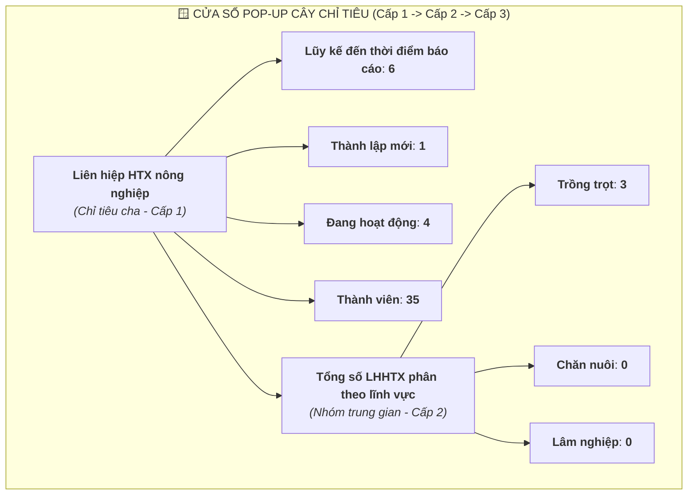

# DANH MỤC CÁC LOẠI CÂU HỎI NGHIỆP VỤ HỆ THỐNG XỬ LÝ

> [!IMPORTANT]
> **Tóm tắt nhanh (30s Overview):** Hệ thống `IPGov_Chatbot` xử lý **5 nhóm câu hỏi nghiệp vụ cốt lõi** trên Kho Dữ Liệu tỉnh Lâm Đồng, bao gồm các truy vấn đơn chỉ tiêu và đa chỉ tiêu/xu hướng song song (`REQ-Q02-DUAL`), đồng thời hỗ trợ đính kèm **🎫 Ticket Thời Gian** (ngày cụ thể, tháng, quý, bán niên, lũy kế) trực tiếp vào từng câu hỏi gốc.

| Mã loại | Nhóm câu hỏi nghiệp vụ hệ thống xử lý | Nhánh con & Ticket đính kèm | Định dạng đầu ra |
| :---: | :--- | :--- | :--- |
| **[`REQ-Q01`](#1-loại-1-req-q01-liệt-kê-danh-sách-các-chỉ-tiêu)** | **Liệt Kê Danh Sách Các Chỉ Tiêu** | • **Nhánh 1.1 (`REQ-Q04`):** Chỉ tiêu Cấp 1 của Nhiệm vụ<br/>• **🎫 Ticket Thời Gian:** Lọc theo Tháng / Quý / Bán niên / Khoảng tháng<br/>• **`SC-1.2` / `SC-4.2`:** Kỳ hoặc nhiệm vụ chưa có dữ liệu duyệt | Bảng 7 cột Cấp 1 + Pop-up Cây chỉ tiêu |
| **[`REQ-Q02`](#2-loại-2-req-q02-tra-cứu-thông-tin-của-một-chỉ-tiêu)** | **Tra Cứu Thông Tin Của Một Chỉ Tiêu** | • **Mặc định:** Chỉ tiêu lá đơn lẻ (có số liệu hoặc chưa có số liệu `'-'`)<br/>• **`SC-2.1`:** Chỉ tiêu lá nằm ở nhiều nhánh cha<br/>• **`SC-2.1b`:** Chỉ tiêu lá định danh kèm nhánh cha (Branch-Scoped Leaf Resolution)<br/>• **`SC-2.4`:** Chỉ tiêu cha (có số liệu hoặc rỗng) + Gợi ý chỉ tiêu con qua action chips duy nhất dưới đáy<br/>• **`SC-2.5`:** Phân cấp & Liệt kê danh mục con (Hierarchy Breakdown — R3)<br/>• **`SC-2.6`:** Phân định Lũy kế vs Trong năm vs Nút lá OCOP (NLU Disambiguation — R4)<br/>• **🎫 Ticket Thời Gian (`slider-time`):** Bộ chọn thời gian tinh gọn 50+, đồng bộ phản ứng 0ms giữa 5 trường và action chips | Thẻ 5 trường + Thanh timeline tinh gọn / Bảng 6 cột / Nút gợi ý chỉ tiêu con duy nhất |
| **[`REQ-Q02-DUAL`](#-sc-27--req-q02-dual-truy-vấn-đa-chỉ-tiêu-so-sánh-xu-hướng-tính-tỷ-trọng-động--xử-lý-ranh-giới-dữ-liệu)** | **Truy Vấn Đa Chỉ Tiêu, Xu Hướng & Tỷ Trọng Động** | • **Model 1:** Thẻ Đối Chiếu Song Song Đa Chỉ Tiêu (Side-by-Side Multi-Metric Cards)<br/>• **Model 2:** Xử Lý Bất Đối Xứng Kỳ Thời Gian (Asymmetric Temporal Availability)<br/>• **Model 3:** Tính Toán Tỷ Trọng & Tỷ Lệ Động (Dynamic Ratio & Percentage Computation)<br/>• **Model 4:** So Sánh Xu Hướng Phân Vùng Đa Kỳ (Multi-Period Partitioned Trend Comparison)<br/>• **Bất Biến:** Chống cộng dồn Snapshot (Anti-SUM Snapshot Invariant)<br/>• **Ranh Giới:** Giới hạn dữ liệu kho `[2026-01-01, 2026-10-31]`, bảo vệ máy tính số học vs tổng hợp DWH | Thẻ đôi 5 trường / Bảng tỷ trọng (%) / Bảng đối chiếu biến động đa kỳ / Thẻ hợp nhất cha |
| **[`REQ-Q03`](#3-loại-3-req-q03-liệt-kê-các-nhiệm-vụ-trong-một-lĩnh-vực)** | **Liệt Kê Các Nhiệm Vụ Trong Một Lĩnh Vực** | • **🎫 Ticket Thời Gian:** Lọc nhiệm vụ có báo cáo trong kỳ<br/>• **`SC-3.2`:** Lĩnh vực không tồn tại | Bảng 5 cột + Nút chuyển tiếp xem chỉ tiêu Cấp 1 |
| **[`REQ-Q05`](#4-loại-4-req-q05-kiểm-toán-báo-cáo-biểu-mẫu--phân-công-nhiệm-vụ)** | **Kiểm Toán Báo Cáo, Biểu Mẫu & Phân Công Nhiệm Vụ** | • **`SC-5.1`:** Tiến độ kỳ báo cáo & Đối chiếu bản nháp<br/>• **`SC-5.2`:** Biểu mẫu & Bộ thu thập chỉ tiêu<br/>• **`SC-5.3`:** Ma trận phân công Phòng ban & Cá nhân | Bảng 9 kỳ báo cáo / Bảng 5 bộ thu thập / Ma trận 8 nhiệm vụ |

---

## 1. LOẠI 1 (`REQ-Q01`): Liệt Kê Danh Sách Các Chỉ Tiêu

### A. Câu hỏi mẫu nghiệp vụ
> [!TIP]
> **🎯 Sample Prompts (`REQ-Q01` — Liệt kê danh sách các chỉ tiêu toàn cục / theo đơn vị):**
> - <mark>**"Hệ thống hiện đang thu thập những chỉ tiêu nào trong năm 2026?"**</mark>
> - <mark>**"Liệt kê số lượng các chỉ tiêu từ tháng 2 đến tháng 8 năm nay?"**</mark>
> - <mark>**"Liệt kê số lượng các chỉ tiêu trong tháng 9?"**</mark>
> - <mark>**"Liệt kê danh sách chỉ tiêu của Phòng nông nghiệp trong quý 2 và quý 3?"**</mark>

### B. Logic hoạt động
- Truy xuất các bản ghi báo cáo đã phê duyệt và gom về đầu mục chỉ tiêu gốc Cấp 1 trên **Bảng 7 cột**.
- Tách bạch 2 cột độc lập:
  1. **`Giá trị mới nhất`**: Hiển thị giá trị thực tế của chính chỉ tiêu Cấp 1 đó (hoặc `Chưa có số liệu phê duyệt (-)` nếu chỉ tiêu Cấp 1 không có số liệu riêng).
  2. **`Chỉ tiêu con`**: Hiển thị nút **`- (Xem chi tiết con)`** nếu có nhánh con Cấp 2, Cấp 3 hoặc **`Không có`** nếu là chỉ tiêu đơn.

### C. Định dạng câu trả lời (Output mẫu — Bảng 7 Cột)

| STT | Tên chỉ tiêu Cấp 1 | Loại cấu trúc | Giá trị mới nhất | Chỉ tiêu con | Đơn vị thực hiện | Nhiệm vụ trọng tâm |
| :---: | :--- | :--- | :---: | :---: | :--- | :--- |
| 1 | **Tổng hộ sản xuất muối** | Chỉ tiêu đơn *(Cấp 1)* | **660** | Không có | Chi cục | Diêm nghiệp |
| 2 | **Tổng diện tích sản xuất muối** | Nhóm chỉ tiêu *(2 chỉ tiêu con)* | **1.520** | **`- (Xem chi tiết con)`** | Chi cục | Diêm nghiệp |
| 3 | **Liên hiệp HTX nông nghiệp** | Nhóm chỉ tiêu *(8 chỉ tiêu con)* | **Chưa có số liệu phê duyệt (-)** | **`- (Xem chi tiết con)`** | Chi cục | Phát triển nông thôn |
| 4 | **HTX nông nghiệp** | Nhóm chỉ tiêu *(12 chỉ tiêu con)* | **Chưa có số liệu phê duyệt (-)** | **`- (Xem chi tiết con)`** | Chi cục | Phát triển nông thôn |
| 5 | **Trang trại** | Nhóm chỉ tiêu *(9 chỉ tiêu con)* | **Chưa có số liệu phê duyệt (-)** | **`- (Xem chi tiết con)`** | Chi cục | Phát triển nông thôn |

- **Tương tác khi bấm `- (Xem chi tiết con)`:** Mở **Cửa sổ Pop-up** vẽ sơ đồ cây phân cấp từ Cấp 1 $\to$ Cấp 2 $\to$ Cấp 3 kèm số liệu mới nhất trong kỳ:



### D. Các nhánh con & Ticket thời gian của Loại 1

#### 🔹 Nhánh 1.1 (`REQ-Q04`): Hiển thị các chỉ tiêu Cấp 1 của Nhiệm vụ
> [!TIP]
> **🎯 Sample Prompts (`REQ-Q04` — Chỉ tiêu Cấp 1 theo nhiệm vụ):**
> - <mark>**"Hiển thị các chỉ tiêu cấp 1 của nhiệm vụ Phát triển nông thôn?"**</mark>
> - <mark>**"Nhiệm vụ Diêm nghiệp có những chỉ tiêu cấp 1 nào?"**</mark>
> - <mark>**"Danh sách các chỉ tiêu cấp đầu hiện có trong nhiệm vụ phát triển nông thôn là gì?"**</mark>
> - <mark>**"Liệt kê các chỉ tiêu cấp 1 của các nhiệm vụ trọng tâm hiện nay?"**</mark>

- **Output mẫu (Bảng 7 cột theo Nhiệm vụ):**

| STT | Nhiệm vụ | Tên chỉ tiêu Cấp 1 | Loại cấu trúc Cấp 1 | Giá trị mới nhất | Chỉ tiêu con | Đơn vị thực hiện |
| :---: | :--- | :--- | :--- | :---: | :---: | :--- |
| 1 | Diêm nghiệp | **Tổng hộ sản xuất muối** | Chỉ tiêu đơn *(Nút lá Cấp 1)* | **660** | Không có | Chi cục |
| 2 | Diêm nghiệp | **Tổng diện tích sản xuất muối** | Nhóm chỉ tiêu *(2 chỉ tiêu con)* | **1.520** | **`- (Xem chi tiết con)`** | Chi cục |
| 3 | Diêm nghiệp | **Tổng sản lượng muối** | Nhóm chỉ tiêu *(2 chỉ tiêu con)* | **27.000** | **`- (Xem chi tiết con)`** | Chi cục |

#### 🎫 Ticket Thời Gian (`Ticket-Time` cho `REQ-Q01` & `REQ-Q04`): Liệt kê danh sách chỉ tiêu theo khoảng thời gian
> [!TIP]
> **🎫 Sample Prompts khi gắn Ticket Thời Gian vào `REQ-Q01` / `REQ-Q04`:**
> - <mark>**"Từ tháng 4 đến tháng 9 có các chỉ tiêu nào?"**</mark> *(Khoảng tháng)*
> - <mark>**"Trong quý 2 năm nay có những chỉ tiêu nào được thu thập?"**</mark> *(Quý)*
> - <mark>**"Liệt kê số lượng các chỉ tiêu trong nửa đầu năm 2026?"**</mark> *(Bán niên)*
> - <mark>**"Trong quý 3, nhiệm vụ Diêm nghiệp có những chỉ tiêu cấp 1 nào được báo cáo?"**</mark> *(Nhiệm vụ + Quý)*

- **Cơ chế Ticket Thời Gian:**
  - Khi câu hỏi đính kèm mốc/khoảng thời gian (*tháng lẻ*, *từ tháng X đến tháng Y*, *quý 1..4*, *nửa đầu năm*, *nửa cuối năm*, *lũy kế từ đầu năm*), hệ thống lọc các bản ghi đã phê duyệt đúng trong khoảng ngày bắt đầu – kết thúc của kỳ (áp dụng cho cả **Bảng 7 cột** lẫn cây chỉ tiêu trong **Pop-up**).
  - **Trường hợp kỳ hoặc nhiệm vụ chưa phát sinh dữ liệu duyệt (`SC-1.2` / `SC-4.2`):**
    - VD kỳ trống (<mark>*"Các chỉ tiêu thu thập trong tháng 1 năm 2024 là gì?"*</mark>): *"Hiện tại chưa ghi nhận bản ghi chỉ tiêu nào được phê duyệt trong kỳ tháng 01/2024. Đồng chí có thể tra cứu dữ liệu kỳ năm 2026."*
    - VD nhiệm vụ chưa có báo cáo duyệt (<mark>*"Nhiệm vụ Cải cách hành chính năm 2026 có các chỉ tiêu nào?"*</mark>): *"Nhiệm vụ **'Cải cách hành chính'** (do **Phòng kinh tế** phụ trách) hiện đã có trong danh mục nhiệm vụ năm 2026, nhưng **chưa phát sinh bản ghi chỉ tiêu báo cáo nào được phê duyệt** trong hệ thống."*

---

## 2. LOẠI 2 (`REQ-Q02`): Tra Cứu Thông Tin Của Một Chỉ Tiêu

### A. Câu hỏi mẫu nghiệp vụ
> [!TIP]
> **🎯 Sample Prompts (`REQ-Q02` — Chỉ tiêu lá đơn lẻ):**
> - <mark>**"Cho tôi biết tổng hộ sản xuất muối năm 2026 là bao nhiêu?"**</mark>
> - <mark>**"Số lượng sản phẩm OCOP 3 sao đã được công nhận là bao nhiêu?"**</mark>
> - <mark>**"Doanh thu bình quân trong năm của một hợp tác xã nông nghiệp là bao nhiêu?"**</mark>
> - <mark>**"Chỉ tiêu liên kết sản xuất của Tổ hợp tác năm 2026 là bao nhiêu?"**</mark>

### B. Logic hoạt động
- Đối chiếu tên chỉ tiêu trong danh mục:
  1. **Chỉ tiêu lá đơn lẻ:** Lấy bản ghi phê duyệt mới nhất và hiển thị **Thẻ 5 Trường Chuẩn** (nếu giá trị trong kho đang trống hoặc `'-'` thì hiển thị `Chưa có số liệu phê duyệt (-)`).
  2. **Chỉ tiêu lá nằm ở nhiều nhánh cha (`SC-2.1`):** Hiển thị **Bảng 6 cột** đối chiếu toàn bộ các nhánh cha.
  3. **Chỉ tiêu cha (`SC-2.4`):** Nếu chỉ tiêu cha **có số liệu** thì hiển thị **Thẻ 5 Trường Chuẩn** kèm các **Button gợi ý chỉ tiêu con**; nếu chỉ tiêu cha **không có số liệu** thì hiển thị thông báo kèm các **Button gợi ý chỉ tiêu con**.

### C. Định dạng câu trả lời (Output mẫu — Thẻ 5 Trường Chuẩn)

- **Mẫu 1 — Khi chỉ tiêu có số liệu phê duyệt:**
  ```markdown
  Thông tin số liệu mới nhất của chỉ tiêu đồng chí tra cứu:
  - **Chỉ tiêu:** Tổng hộ sản xuất muối *(Chỉ tiêu gốc - Cấp 1)*
  - **Giá trị:** **660**
  - **Đơn vị thực hiện:** Chi cục
  - **Nhiệm vụ trọng tâm:** Diêm nghiệp
  - **Thời điểm báo cáo:** 30/09/2026
  ```
- **Mẫu 2 — Khi chỉ tiêu có trong danh mục nhưng chưa có số liệu trong kỳ (`'-'`):**
  ```markdown
  Thông tin số liệu mới nhất của chỉ tiêu đồng chí tra cứu:
  - **Chỉ tiêu:** Liên kết sản xuất *(Thuộc nhóm: Tổ hợp tác - Cấp 2)*
  - **Giá trị:** Chưa có số liệu phê duyệt (-)
  - **Đơn vị thực hiện:** Chi cục
  - **Nhiệm vụ trọng tâm:** Phát triển nông thôn
  - **Thời điểm báo cáo:** 30/09/2026
  ```

### D. Các nhánh con & Ticket thời gian của Loại 2

#### 🔹 `SC-2.1`: Chỉ tiêu lá nằm ở nhiều nhánh chỉ tiêu cha khác nhau
> [!TIP]
> **🎯 Sample Prompts (`SC-2.1` — Các chỉ tiêu lá xuất hiện ở nhiều nhánh cha *HTX*, *LHHTX*, *Tổ hợp tác*, *Trang trại*):**
> - <mark>**"Chỉ tiêu thành lập mới hiện tại là bao nhiêu?"**</mark>
> - <mark>**"Cho tôi xem số liệu chỉ tiêu đang hoạt động?"**</mark>
> - <mark>**"Chỉ tiêu trồng trọt hiện đạt bao nhiêu?"**</mark>
> - <mark>**"Số lượng chỉ tiêu trồng trọt ngày 30/4?"**</mark> *(Kết hợp `🎫 Ticket thời gian`)*

- **Output mẫu (Bảng 6 cột đối chiếu toàn bộ các nhánh cha):**

| STT | Tên chỉ tiêu | Nhóm chỉ tiêu (Cấp) | Giá trị mới nhất | Đơn vị thực hiện | Nhiệm vụ trọng tâm |
| :---: | :--- | :--- | :---: | :--- | :--- |
| 1 | Trồng trọt | HTX nông nghiệp > Số lượng HTX phân theo lĩnh vực *(Cấp 2)* | **26** | Chi cục | Phát triển nông thôn |
| 2 | Trồng trọt | Liên hiệp HTX nông nghiệp > Tổng số LHHTX phân theo lĩnh vực *(Cấp 2)* | **3** | Chi cục | Phát triển nông thôn |
| 3 | Trồng trọt | Tổ hợp tác nông nghiệp > Tổng số THT phân theo lĩnh vực *(Cấp 2)* | **12** | Chi cục | Phát triển nông thôn |
| 4 | Trồng trọt | Trang trại > Tổng số trang trại *(Cấp 2)* | **16** | Chi cục | Phát triển nông thôn |

#### 🔹 `SC-2.1b`: Chỉ tiêu lá nằm ở nhiều nhánh cha nhưng câu hỏi đã nêu rõ thực thể / nhánh cha (Branch-Scoped Single Criterion)
> [!TIP]
> **🎯 Sample Prompts (`SC-2.1b` — Định danh trực tiếp chỉ tiêu con khi người dùng chỉ rõ nhánh cha):**
> - <mark>**"cho tôi biết số liệu chăn nuôi của liên hiệp hợp tác xã ngày 30/4"**</mark> *(Định danh nhánh Liên hiệp HTX)*
> - <mark>**"chăn nuôi của hợp tác xã nông nghiệp"**</mark> *(Định danh nhánh HTX)*
> - <mark>**"số liệu trồng trọt của tổ hợp tác nông nghiệp"**</mark> *(Định danh nhánh THT)*
> - <mark>**"thông tin chăn nuôi của trang trại"**</mark> *(Định danh nhánh Trang trại)*

- **Logic hoạt động:**
  Khi câu hỏi chứa tên của chỉ tiêu lá (như *Chăn nuôi*, *Trồng trọt*) đồng thời chứa tên của thực thể/nhánh cha (như *Liên hiệp HTX*, *Hợp tác xã*, *Tổ hợp tác*, *Trang trại*), hệ thống thực hiện chuẩn hóa từ viết tắt hai chiều (`liên hiệp hợp tác xã` / `liên hiệp htx` $\leftrightarrow$ `lhhtx`, `hợp tác xã` $\leftrightarrow$ `htx`, `tổ hợp tác` $\leftrightarrow$ `tht`, `trang trại` $\leftrightarrow$ `tt`) để phân giải trực tiếp và tất định về đúng chỉ tiêu lá thuộc nhánh cha được chỉ định.
- **Output mẫu (Thẻ 5 Trường Chuẩn — Bỏ qua bảng đối chiếu 4 nhánh cha):**
  Hệ thống xuất trực tiếp **Thẻ 5 Trường Chuẩn** (kèm mốc thời gian đối chiếu gần nhất nếu có ngày cụ thể) thay vì hiển thị bảng so sánh 4 nhánh:
  ```markdown
  Thông tin số liệu mới nhất của chỉ tiêu đồng chí tra cứu:
  - **Chỉ tiêu:** Chăn nuôi *(Thuộc nhóm: Tổng số LHHTX phân theo lĩnh vực - Cấp 2)*
  - **Giá trị:** **1**
  - **Đơn vị thực hiện:** Chi cục
  - **Nhiệm vụ trọng tâm:** Phát triển nông thôn
  - **Thời điểm báo cáo:** 31/03/2026 *(Lưu ý mốc thời gian: Dữ liệu được đối chiếu tại kỳ báo cáo gần nhất ngày 31/03/2026, lệch 30 ngày so với ngày yêu cầu 30/04/2026)*
  ```

#### 🔹 `SC-2.4`: Hỏi vào tên một chỉ tiêu cha (có các chỉ tiêu con bên dưới)
> [!TIP]
> **🎯 Sample Prompts (`SC-2.4`):**
> - <mark>**"Tổng số lượng chủ thể sản phẩm OCOP trong năm là bao nhiêu?"**</mark> *(Chỉ tiêu cha **có số liệu**)*
> - <mark>**"Cho tôi biết số liệu chỉ tiêu Liên hiệp HTX nông nghiệp?"**</mark> *(Chỉ tiêu cha **không có số liệu**)*
> - <mark>**"Thông tin số liệu Chương trình OCOP hiện tại là bao nhiêu?"**</mark> *(Chỉ tiêu cha **không có số liệu**)*
> - <mark>**"Số liệu chỉ tiêu trang trại ngày 23/4 là bao nhiêu?"**</mark> *(Chỉ tiêu cha kết hợp `🎫 Ticket thời gian`)*

- **Trường hợp 1 (`SC-2.4a`) — Chỉ tiêu cha CÓ số liệu tổng hợp (VD: `'Tổng số lượng chủ thể sản phẩm OCOP trong năm'` có giá trị `17` tại kỳ `30/09/2026`):**
  - Hiển thị **Thẻ 5 Trường Chuẩn** của chỉ tiêu cha kèm các **Nút gợi ý chỉ tiêu con tương tác** (`quick_action_chips`) ở đáy:
  ```markdown
  Thông tin số liệu mới nhất của chỉ tiêu đồng chí tra cứu:
  - **Chỉ tiêu:** Tổng số lượng chủ thể sản phẩm OCOP trong năm *(Thuộc nhóm: Chương trình OCOP - Cấp 2)*
  - **Giá trị:** **17**
  - **Đơn vị thực hiện:** Chi cục
  - **Nhiệm vụ trọng tâm:** Phát triển nông thôn
  - **Thời điểm báo cáo:** 30/09/2026

  Đồng chí có thể bấm chọn một trong các **chỉ tiêu con trực thuộc** ở bên dưới để xem chi tiết.
  ```
  > [!NOTE]
  > **Quy tắc hiển thị nút chỉ tiêu con duy nhất:** Các nút gợi ý chỉ tiêu con xuất hiện **duy nhất 1 lần** dưới dạng các action chips tương tác (`quick_action_chips`) đặt ở đáy tin nhắn. Tuyệt đối không chèn lặp danh sách text inline `🔘 [...]` vào cuối đoạn văn bản markdown.

- **Trường hợp 2 (`SC-2.4b`) — Chỉ tiêu cha KHÔNG có số liệu tổng hợp (VD: `'Liên hiệp HTX nông nghiệp'`):**
  > *"Chỉ tiêu **'Liên hiệp HTX nông nghiệp'** là một **chỉ tiêu cha (nhóm chỉ tiêu)** nên không có số liệu tổng hợp riêng lẻ. Đồng chí vui lòng bấm chọn một trong các **chỉ tiêu con đang có số liệu** trực thuộc nhóm này ở bên dưới để xem chi tiết."*
  >
  > *(Các nút gợi ý chỉ tiêu con hiển thị duy nhất dạng interactive action chips ở đáy tin nhắn, không nhân bản text inline `🔘 [...]` trong văn bản).*

#### 🎫 Ticket Thời Gian (`slider-time` / `Ticket-Time` cho toàn bộ `REQ-Q02`): Lọc số liệu theo ngày cụ thể, khoảng thời gian hoặc bộ chọn mốc thời gian tinh gọn
> [!TIP]
> **🎫 Sample Prompts khi gắn Ticket Thời Gian (`slider-time`) vào Chỉ tiêu lá đơn lẻ / Chỉ tiêu lá đa nhánh (`SC-2.1`) / Chỉ tiêu cha (`SC-2.4`):**
> - <mark>**"Cho tôi biết số liệu chỉ tiêu tổng hộ sản xuất muối vào ngày 30/9?"**</mark> *(Chỉ tiêu lá đơn lẻ + Ngày)*
> - <mark>**"Chỉ tiêu sản lượng muối công nghiệp trong quý 2 năm 2026 là bao nhiêu?"**</mark> *(Chỉ tiêu lá đơn lẻ + Quý)*
> - <mark>**"Số lượng chỉ tiêu trồng trọt ngày 30/4?"**</mark> *(Chỉ tiêu lá đa nhánh `SC-2.1` + Ngày)*
> - <mark>**"Số liệu chỉ tiêu trang trại ngày 23/4 là bao nhiêu?"**</mark> *(Chỉ tiêu cha `SC-2.4` + Ngày)*
> - <mark>**"Tổng diện tích sản xuất muối trong nửa đầu năm 2026 là bao nhiêu?"**</mark> *(Chỉ tiêu cha `SC-2.4` + Khoảng thời gian)*

- **Cơ chế Ticket Thời Gian (`slider-time`) trên `REQ-Q02` (Áp dụng đồng nhất cho cả Chỉ tiêu lá đơn lẻ, `SC-2.1` và `SC-2.4`):**
  1. **Khi gắn mốc ngày cụ thể $a$ (trên dãy mốc báo cáo $D = [A, B, C, \dots]$):** Xác định khoảng $[A, B]$ chứa $a$, so sánh khoảng cách $\Delta_A = a - A$ và $\Delta_B = B - a$ để chọn kỳ báo cáo gần nhất (nếu $\Delta_A = \Delta_B$ thì ưu tiên cận trên $B$). *Ví dụ:* các mốc `[31/03, 30/06, 30/09]`, hỏi ngày `30/04` hoặc `23/04` $\to$ đối chiếu về kỳ báo cáo gần nhất ngày **`31/03/2026`** và thông báo rõ ngày đối chiếu.
  2. **Khi gắn khoảng thời gian (tháng, quý, nửa đầu năm, lũy kế...):** Lấy bản ghi tại kỳ báo cáo mới nhất nằm trong khoảng thời gian đó.
  3. **Bộ chọn mốc thời gian tinh gọn tối ưu cho cán bộ cao tuổi (Senior-Friendly Unified Timeline Selector & Đồng bộ phản ứng 0ms):**
     - Loại bỏ hoàn toàn khối 3 hộp rời rạc rườm rà phía trên (`Số liệu phê duyệt`, `Đơn vị thực hiện`, `Nhiệm vụ / Biểu mẫu`) và các nhãn dev kỹ thuật (`Ticket slider-time • 0ms`) gây phân tán thị giác cho người dùng từ 50 tuổi trở lên.
     - Tái cấu trúc thành **Thanh điều khiển kỳ báo cáo đồng nhất** tích hợp liền khối ngay trên danh sách 5 trường chuẩn (`Chỉ tiêu`, `Giá trị`, `Đơn vị thực hiện`, `Nhiệm vụ trọng tâm`, `Thời điểm báo cáo`), thiết kế nút bấm kỳ lớn (`px-3 py-1.5`, `font-bold`), tương phản cao, ô nhập ngày tùy chỉnh và nút Ghim (`📌`).
     - **Đồng bộ phản ứng tức thì (`0ms Reactive State Synchronization`):** Khi người dùng bấm chuyển đổi giữa các mốc báo cáo (`31/03/2026`, `30/06/2026`, `30/09/2026`, hoặc ngày tùy chỉnh), hệ thống cập nhật đồng thời trong `0ms` ở phía Client:
       * Giá trị `- **Giá trị:**` và `- **Thời điểm báo cáo:**` (kèm lưu ý lệch ngày nếu có) trong khối văn bản 5 trường chi tiết.
       * Huy hiệu số liệu xem trước (`preview_value` badge) trên **tất cả các nút gợi ý chỉ tiêu con** (`quick_action_chips`) ở đáy tin nhắn.

#### 🔹 `SC-2.5`: Truy Vấn Phân Cấp & Liệt Kê Danh Mục Con Trực Thuộc (Hierarchy Breakdown & Enumeration Queries — R3)
> [!TIP]
> **🎯 Sample Prompts (`SC-2.5` — Liệt kê/đếm các lĩnh vực, phân nhóm, mức đánh giá con của một thực thể trong DWH):**
> - <mark>**"bạn hãy cho tôi biết số lĩnh vực của HTX"**</mark> *(8 lĩnh vực của Hợp tác xã)*
> - <mark>**"Bạn hãy cho tôi biết các mức đánh giá hiệu quả hoạt động của hợp tác xã"**</mark> *(4 mức đánh giá hiệu quả HTX)*
> - <mark>**"Cho tôi biết đang có các loại diện tích sản xuất muối gì?"**</mark> *(2 loại diện tích làm muối)*
> - <mark>**"Liệt kê các lĩnh vực hoạt động của tổ hợp tác nông nghiệp"**</mark> *(8 lĩnh vực của THT)*
> - <mark>**"Cho biết các mức xếp loại hiệu quả của tổ hợp tác"**</mark> *(3 mức xếp loại THT)*
> - <mark>**"Liên hiệp HTX nông nghiệp gồm những lĩnh vực nào?"**</mark> *(8 lĩnh vực của LHHTX)*
> - <mark>**"Trang trại nông nghiệp phân theo những lĩnh vực gì?"**</mark> *(7 lĩnh vực của Trang trại)*
> - <mark>**"Hiện có những loại sản lượng muối nào được thống kê?"**</mark> *(2 loại sản lượng muối)*

- **Logic hoạt động (Warehouse-Grounded NLU Reasoning — Zero Regex / Zero Heuristics):**
  1. **Nhận diện Ý định Liệt kê Danh mục Phân cấp:** Phân biệt chính xác giữa câu hỏi tra cứu giá trị số đo tổng hợp đơn lẻ (`METRIC_POINT_INQUIRY`) với câu hỏi hỏi về **số lượng và danh sách các phân nhóm / cấp bậc / loại hình / lĩnh vực** con tồn tại dưới một thực thể trong kho dữ liệu (`DIMENSION_LISTING` với cờ `is_hierarchical_breakdown=True`).
  2. **Neo Thực thể Gốc & Phân giải Nhóm Cha (Entity Root Anchoring & Aspect Cues):**
     - Trích xuất thực thể gốc để neo ngữ cảnh nhánh cây: `'HTX nông nghiệp'`, `'Tổ hợp tác nông nghiệp'`, `'Liên hiệp HTX nông nghiệp'`, `'Trang trại'`, `'Diêm nghiệp'`, `'Chương trình OCOP'`.
     - Sử dụng chỉ dấu ngữ nghĩa (aspect cues: *lĩnh vực*, *hiệu quả*, *diện tích*, *sản lượng*...) để định vị chính xác nhóm cha trung gian trong nhánh đã neo (tránh nhầm lẫn giữa `'Hiệu quả hoạt động'` của HTX với THT hay Trang trại).
  3. **Truy xuất Danh mục & Dữ liệu Thực thi từ Kho DWH:**
     - Truy vấn các nút con trực thuộc từ `catalog_criteria_hierarchy` (`WHERE parent_id = matched_parent.id`).
     - Kết nối dữ liệu báo cáo phê duyệt mới nhất từ `fact_report_criteria` theo tỉnh (`tenant_code`) và năm (`year_code`).
  4. **Cấm tuyệt đối Anti-Pattern Heuristic:** Nghiêm cấm dùng danh sách từ khóa cố định, so khớp chuỗi regex hoặc chuỗi `if/else` để hardcode danh sách lĩnh vực hay số lượng.

- **Định dạng câu trả lời (Output mẫu — Câu dẫn số lượng + Tên in đậm + Bảng 6 Cột Đầy Đủ):**
  - **Câu dẫn tự nhiên:** Nêu rõ số lượng chính xác tìm thấy trong kho DWH và liệt kê tên in đậm của tất cả các phân nhóm/chỉ tiêu con.
    > *"Trong kho dữ liệu DWH tỉnh Lâm Đồng, hiện có **8** phân nhóm/chỉ tiêu con trực thuộc nhóm **'Số lượng HTX phân theo lĩnh vực'** (thuộc **HTX nông nghiệp**) gồm: **Trồng trọt**, **Chăn nuôi**, **Lâm nghiệp**, **Thủy sản**, **Diêm nghiệp**, **Chế biến nông sản**, **Nước sạch NT**, **Tổng hợp**:"*
  - **Bảng 6 Cột Đầy Đủ Thông Tin:**

| STT | Tên chỉ tiêu | Nhóm chỉ tiêu | Giá trị mới nhất | Đơn vị thực hiện | Nhiệm vụ trọng tâm |
| :---: | :--- | :--- | :---: | :--- | :--- |
| 1 | **Trồng trọt** | Số lượng HTX phân theo lĩnh vực *(Cấp 2)* | **26** | Chi cục | Phát triển nông thôn |
| 2 | **Chăn nuôi** | Số lượng HTX phân theo lĩnh vực *(Cấp 2)* | **64** | Chi cục | Phát triển nông thôn |
| 3 | **Lâm nghiệp** | Số lượng HTX phân theo lĩnh vực *(Cấp 2)* | **0** | Chi cục | Phát triển nông thôn |
| 4 | **Thủy sản** | Số lượng HTX phân theo lĩnh vực *(Cấp 2)* | **2** | Chi cục | Phát triển nông thôn |
| 5 | **Diêm nghiệp** | Số lượng HTX phân theo lĩnh vực *(Cấp 2)* | **0** | Chi cục | Phát triển nông thôn |
| 6 | **Chế biến nông sản** | Số lượng HTX phân theo lĩnh vực *(Cấp 2)* | **0** | Chi cục | Phát triển nông thôn |
| 7 | **Nước sạch NT** | Số lượng HTX phân theo lĩnh vực *(Cấp 2)* | **1** | Chi cục | Phát triển nông thôn |
| 8 | **Tổng hợp** | Số lượng HTX phân theo lĩnh vực *(Cấp 2)* | **45** | Chi cục | Phát triển nông thôn |

  - **Cấu trúc dữ liệu bảng kèm theo:** Trả về bảng số liệu chuẩn hóa (6 cột) và các nút gợi ý chỉ tiêu con để người dùng bấm tra cứu sâu hơn (chỉ hiển thị ở đáy, không nhân bản text inline).

#### 🔹 `SC-2.6`: Phân Định Ngữ Nghĩa Chỉ Tiêu Lũy Kế vs Trong Năm vs Nút Lá OCOP (Cumulative vs Annual vs Leaf Disambiguation — R4)
> [!TIP]
> **🎯 Sample Prompts (`SC-2.6` — Phân định rõ chỉ tiêu lũy kế với chỉ tiêu trong năm hoặc các hạng sao OCOP lá con):**
> - <mark>**"bạn hãy cho tôi biết lũy kế tổng số lượng chủ thể sản phẩm theo dữ liệu mới nhất"**</mark> *(Phân giải về `Lũy kế  tổng số lượng chủ thể đến thời điểm báo cáo`)*
> - <mark>**"bạn hãy cho tôi biết lũy kế tổng số lượng chủ thể sản phẩm OCOP theo dữ liệu mới nhất"**</mark> *(Phân giải về `Lũy kế  tổng số lượng sản phẩm OCOP đến thời điểm báo cáo`)*
> - <mark>**"Tổng số lượng chủ thể OCOP lũy kế đến thời điểm báo cáo là bao nhiêu?"**</mark>
> - <mark>**"Số lượng sản phẩm OCOP lũy kế đến thời điểm báo cáo là bao nhiêu?"**</mark>

- **Logic hoạt động (Semantic Scoring & Candidate Pool Sizing — Khắc phục Bẫy Token Overlap):**
  1. **Thách thức:** Các chỉ tiêu OCOP chia sẻ mật độ từ khóa rất cao (*chủ thể*, *sản phẩm*, *OCOP*, *tổng số lượng*), dễ khiến cơ chế so khớp token mờ truyền thống xếp nhầm các nút lá con (`Số lượng chủ thể sản phẩm OCOP 5 sao`) hoặc nhóm hàng năm (`Tổng số lượng chủ thể sản phẩm OCOP trong năm`) lên vị trí đầu.
  2. **Mở rộng Kích thước Tập Ứng viên (Candidate Pool Sizing):** Thiết lập `candidate_pool_size = max(top_k * 5, 25)` trong bước truy hồi DuckDB Catalog (`find_criteria_by_name`), ngăn chặn việc cắt tỉa ứng viên quá sớm trước khi chuyển sang bộ xếp hạng tinh (reranker). Các chỉ tiêu có khoảng trắng đôi trong CSDL (`"Lũy kế  tổng số lượng..."`) được bảo toàn trọn vẹn trong pool.
  3. **Chấm điểm Phân cực Thời gian (Temporal Polarity Scoring):**
     - Khi câu hỏi mang tín hiệu lũy kế (*lũy kế*, *đến thời điểm báo cáo*): Ứng viên lũy kế nhận điểm thưởng $\Delta_{\text{temporal}} = +25.0$; ứng viên hàng năm (*trong năm*) nhận điểm phạt $\Delta_{\text{temporal}} = -30.0$.
     - Khi câu hỏi mang tín hiệu hàng năm (*trong năm*): Ứng viên hàng năm nhận $+25.0$; ứng viên lũy kế nhận $-30.0$.
  4. **Phạt Tính Đặc thù Xếp hạng Sao OCOP (Star Rating Specificity Penalty):**
     - Khi câu hỏi của người dùng **KHÔNG** yêu cầu tường minh thứ hạng sao (*"3 sao"*, *"4 sao"*, *"5 sao"*), tất cả các chỉ tiêu lá con mang xếp hạng sao đều nhận điểm phạt $\Delta_{\text{star}} = -25.0$. Cơ chế này ngăn chặn việc nhóm chỉ tiêu tổng quát bị nuốt nhầm vào một nút lá 5 sao.
  5. **Phân cực Đối tượng Thực thể (Entity Subject vs Product Polarity):**
     - Khi câu hỏi hỏi về *chủ thể* mà không hỏi riêng *sản phẩm*: Ứng viên chứa từ khóa *chủ thể* nhận $+15.0$, ứng viên chỉ chứa *sản phẩm* nhận $-15.0$.
  6. **Kết quả Đầu ra:** Hệ thống giải quyết chính xác về nhóm chỉ tiêu cha lũy kế tương ứng (`Lũy kế  tổng số lượng chủ thể đến thời điểm báo cáo` hoặc `Lũy kế  tổng số lượng sản phẩm OCOP đến thời điểm báo cáo`), xuất Thẻ 5 trường chuẩn kèm các nút gợi ý chỉ tiêu con tương tác ở đáy (`quick_action_chips`).

#### 🔹 `SC-2.7` / `REQ-Q02-DUAL`: Truy Vấn Đa Chỉ Tiêu, So Sánh Xu Hướng, Tính Tỷ Trọng Động & Xử Lý Ranh Giới Dữ Liệu
> [!TIP]
> **🎯 Sample Prompts (`REQ-Q02-DUAL` — Truy vấn đa chỉ tiêu, so sánh xu hướng 2 kỳ, tính tỷ trọng % và ranh giới kho dữ liệu):**
> - <mark>**"Cho tôi biết số lượng trâu và số lượng bò ngày 16/10/2026 là bao nhiêu?"**</mark> *(TC-01: 2 chỉ tiêu cùng nhánh cha gia súc)*
> - <mark>**"Ngày 16/10/2026, tổng sản lượng muối và số lượng gia súc là bao nhiêu?"**</mark> *(TC-07: 2 chỉ tiêu khác miền, lệch kỳ chốt sổ)*
> - <mark>**"Tổng diện tích sản xuất muối và tổng số hộ sản xuất muối trong 6 tháng đầu năm 2026 là bao nhiêu?"**</mark> *(TC-11: Bẫy cộng dồn chỉ tiêu thời điểm)*
> - <mark>**"Ngày 31/3/2026, sản lượng muối thủ công chiếm bao nhiêu phần trăm trong tổng sản lượng muối? Diện tích muối công nghiệp chiếm bao nhiêu phần trăm tổng diện tích?"**</mark> *(TC-12: Tính toán tỷ trọng % động)*
> - <mark>**"So sánh các chỉ số sản xuất muối giữa ngày 31/3/2026 và ngày 30/6/2026, có sự tăng giảm nào không?"**</mark> *(TC-13: So sánh xu hướng đa kỳ)*
> - <mark>**"Tình hình sản xuất muối và số lượng gia súc ngày 31/7/2026 và 15/10/2026 như thế nào?"**</mark> *(TC-06: Mốc ngày hoàn toàn trống số liệu)*
> - <mark>**"Cho tôi xem sản lượng muối ngày 31/12/2025 hoặc ngày 01/11/2026."**</mark> *(TC-09: Ngoài phạm vi kỳ báo cáo có dữ liệu)*
> - <mark>**"Tính tổng toàn bộ sản lượng muối (bao gồm cả thủ công và công nghiệp) trong ngày 31/3/2026."**</mark> *(TC-10: Tổng hợp DWH chống nhầm máy tính số học)*

---

### A. Tổng Quan Đặc Tả & Cơ Chế Phân Loại Ý Định (Specification Overview)

`REQ-Q02-DUAL` mở rộng năng lực tra cứu của hệ thống từ mô hình truy vấn đơn chỉ tiêu (`Single-Metric Inquiry`) sang **truy vấn đa chỉ tiêu song song, phân tích xu hướng biến động liên kỳ, tính toán tỷ trọng phân tích động và kiểm soát ranh giới dữ liệu kho DWH**:

1. **Phân Tách Mệnh Đề Từ Nối Tự Nhiên (Multi-Indicator Clause Segmentation):**
   - Bộ chuẩn hóa ngữ nghĩa tự động bóc tách các liên từ nối ngôn ngữ tự nhiên: `và`, `,`, `cùng với`, `đồng thời`, `kèm theo`, `với`.
   - Nhận diện các thực thể chỉ tiêu độc lập mà không dựa vào regex cố định hay bộ lọc từ khóa tĩnh (`anti-heuristic`).
2. **Khử Nhập Nhằng Đa Chỉ Tiêu (Multi-Indicator Disambiguation):**
   - Mỗi chỉ tiêu được phân giải độc lập vào danh sách định danh chuẩn hóa theo danh mục nghiệp vụ (Ví dụ: tên chuẩn hóa `["Số lượng trâu", "Số lượng bò"]` hoặc `["Sản lượng muối thủ công", "Tổng sản lượng muối"]`).
   - Kích hoạt chế độ xử lý đa chỉ tiêu khi số lượng chỉ tiêu nhận diện $\ge 2$.
3. **Bộ Định Tuyến 4 Mô Hình Đầu Ra Chuyên Biệt (4 Specialized Synthesis Models):**
   - **Model 1:** Thẻ Đối Chiếu Song Song Đa Chỉ Tiêu (*Side-by-Side Multi-Metric Cards*).
   - **Model 2:** Xử Lý Bất Đối Xứng Kỳ Thời Gian (*Asymmetric Temporal Availability*).
   - **Model 3:** Tính Toán Tỷ Trọng & Tỷ Lệ Động (*Dynamic Ratio & Percentage Computation*).
   - **Model 4:** So Sánh Xu Hướng Phân Vùng Đa Kỳ (*Multi-Period Partitioned Trend Comparison*).
   - **Bảo Vệ Kiến Trúc:** Nguyên tắc bất biến chống cộng dồn Snapshot (*Anti-SUM Snapshot Invariant*), Chốt chặn máy tính số học vs Tổng hợp DWH (*DWH Aggregation Guard*), và Ranh giới dữ liệu kho `[2026-01-01, 2026-10-31]`.

---

### B. Chi Tiết 4 Mô Hình Xử Lý `REQ-Q02-DUAL`

#### 1. MODEL 1: Thẻ Đối Chiếu Song Song Đa Chỉ Tiêu (Side-by-Side Multi-Metric Cards)

- **Nguyên lý hoạt động:**
  Khi người dùng tra cứu từ 2 chỉ tiêu trở lên trong cùng một câu hỏi (ví dụ: *Chi tiêu ngân sách & Đầu tư phát triển*, *Đàn lợn & Đàn gia cầm*, *Sản lượng muối công nghiệp & Diện tích sản xuất muối*, hoặc *Số lượng trâu & Số lượng bò*), hệ thống không ép kết quả vào một cây phân cấp giả định mà dựng các **Thẻ 5 Trường Chuẩn độc lập song song** cho từng chỉ tiêu.
- **Hợp Nhất Nhánh Cha Tự Động (Generic Parent Consolidation Roll-Up):**
  Nếu các chỉ tiêu thành phần thuộc cùng một nhóm cha chung trong CSDL (ví dụ: *Trâu* và *Bò* cùng thuộc *Tổng đàn gia súc*), hệ thống tự động bổ sung dòng tổng hợp hợp nhất toàn tỉnh:
  $$\text{Tổng Hợp Nhất} = \sum_{i=1}^{k} V_i$$
  Đồng thời hiển thị bảng chi tiết các chỉ tiêu kèm mốc thời gian chốt sổ và đơn vị phụ trách.

- **Định dạng Output Mẫu (Markdown):**
  *(Trích xuất từ kết quả thực thi TC-01: Tra cứu số lượng trâu và số lượng bò ngày 16/10/2026 tại Lâm Đồng)*

  ```markdown
  Thông tin số liệu của các chỉ tiêu đồng chí tra cứu vào ngày **16/10/2026** của tỉnh Lâm Đồng:

  ### 1. Chỉ tiêu: **Số lượng trâu**
  - **Chỉ tiêu:** Số lượng trâu *(Thuộc nhóm: Tổng đàn gia súc)*
  - **Giá trị:** **268** con
  - **Đơn vị thực hiện:** Toàn tỉnh
  - **Nhiệm vụ trọng tâm:** Quản lý chỉ tiêu điều hành
  - **Thời điểm báo cáo:** 16/10/2026

  ### 2. Chỉ tiêu: **Số lượng bò**
  - **Chỉ tiêu:** Số lượng bò *(Thuộc nhóm: Tổng đàn gia súc)*
  - **Giá trị:** **413** con
  - **Đơn vị thực hiện:** Toàn tỉnh
  - **Nhiệm vụ trọng tâm:** Quản lý chỉ tiêu điều hành
  - **Thời điểm báo cáo:** 16/10/2026

  📊 **Tổng đàn gia súc (Hợp nhất toàn tỉnh):** **681** con (Số lượng trâu: 268 con, Số lượng bò: 413 con).

  | STT | Chỉ tiêu | Giá trị | Đơn vị thực hiện | Nhiệm vụ trọng tâm | Thời điểm báo cáo |
  | :---: | :--- | :---: | :--- | :--- | :---: |
  | 1 | Số lượng trâu | **268** | Toàn tỉnh | Quản lý chỉ tiêu điều hành | 16/10/2026 |
  | 2 | Số lượng bò | **413** | Toàn tỉnh | Quản lý chỉ tiêu điều hành | 16/10/2026 |
  ```

- **Đặc tả Cấu trúc Dữ liệu Bảng:**
  Dữ liệu bảng được đóng gói dạng bảng thông tin chuẩn gồm các cột định danh, phân nhóm và số liệu phục vụ hiển thị trực quan. Chi tiết cấu trúc kỹ thuật DTO (`tabular_data`) được quy chuẩn tại đặc tả kỹ thuật Module 08.

---

#### 2. MODEL 2: Xử Lý Bất Đối Xứng Kỳ Thời Gian (Asymmetric Temporal Availability)

- **Nguyên lý hoạt động:**
  Trong thực tế vận hành DWH, các nhóm chỉ tiêu thuộc các lĩnh vực khác nhau có chu kỳ thu thập và chốt sổ không đồng nhất (ví dụ: *Diêm nghiệp* chốt sổ theo quý `30/06/2026`, trong khi *Chăn nuôi gia súc* phát sinh đợt tổng điều tra đột xuất ngày `16/10/2026`).
- **Quy tắc điều hướng (Zero Indicator Dropping):**
  1. **Tuyệt đối không bỏ rơi chỉ tiêu:** Hệ thống độc lập phân giải và truy xuất số liệu cho từng chỉ tiêu, không để chỉ tiêu này làm rớt chỉ tiêu kia.
  2. **Thông báo lệch kỳ chuẩn mực (Temporal Shift Notice):**
     - Với chỉ tiêu có số liệu đúng ngày yêu cầu: Xuất Thẻ với giá trị và ngày báo cáo chính xác.
     - Với chỉ tiêu chưa phát sinh số liệu tại ngày yêu cầu: Tự động đối chiếu mốc báo cáo gần nhất có dữ liệu được phê duyệt và ghi chú rõ ràng:
       > `*(Chưa có số liệu tại ngày DD/MM/YYYY; đối chiếu kỳ gần nhất ngày DD/MM/YYYY)*`
  3. **Xử lý thiếu kỳ trong so sánh xu hướng liên kỳ:**
     - Khi một chỉ tiêu chỉ có số liệu ở 1 kỳ và khuyết thiếu hoàn toàn ở kỳ còn lại, hệ thống không bịa đặt số liệu giả mà gắn nhãn đánh giá rõ ràng:
       > Nhãn xu hướng: *"Chưa đủ số liệu 2 kỳ để so sánh"* (hoặc *"Chưa đủ số liệu 2 kỳ"*), Tốc độ biến động và Chênh lệch: *"N/A"*.

- **Định dạng Output Mẫu (Markdown):**
  *(Trích xuất từ kết quả thực thi TC-07: Ngày 16/10/2026, tổng sản lượng muối và số lượng gia súc là bao nhiêu?)*

  ```markdown
  Thông tin số liệu của các chỉ tiêu đồng chí tra cứu vào ngày **16/10/2026** của tỉnh Lâm Đồng:

  ### 1. Chỉ tiêu: **Tổng sản lượng muối**
  - **Chỉ tiêu:** Tổng sản lượng muối *(Chỉ tiêu độc lập)*
  - **Giá trị:** **27.000** tấn
  - **Đơn vị thực hiện:** Chi cục
  - **Nhiệm vụ trọng tâm:** Diêm nghiệp
  - **Thời điểm báo cáo:** 30/06/2026 *(Chưa có số liệu tại ngày 16/10/2026; đối chiếu kỳ gần nhất ngày 30/06/2026)*

  ### 2. Chỉ tiêu: **Tổng đàn gia súc**
  - **Chỉ tiêu:** Tổng đàn gia súc *(Chỉ tiêu độc lập)*
  - **Giá trị:** **681** con
  - **Đơn vị thực hiện:** Toàn tỉnh
  - **Nhiệm vụ trọng tâm:** Quản lý chỉ tiêu điều hành
  - **Thời điểm báo cáo:** 16/10/2026

  | STT | Chỉ tiêu | Giá trị | Đơn vị thực hiện | Nhiệm vụ trọng tâm | Thời điểm báo cáo |
  | :---: | :--- | :---: | :--- | :--- | :---: |
  | 1 | Tổng sản lượng muối | **27.000** tấn | Chi cục | Diêm nghiệp | 30/06/2026 *(Lệch kỳ: 16/10/2026)* |
  | 2 | Tổng đàn gia súc | **681** con | Toàn tỉnh | Quản lý chỉ tiêu điều hành | 16/10/2026 |
  ```

---

#### 3. MODEL 3: Tính Toán Tỷ Trọng & Tỷ Lệ Động (Dynamic Ratio & Percentage Computation)

- **Công thức tính toán toán học (Mathematical Formulation):**
  $$\text{Tỷ trọng (\%)} = \left( \frac{\text{Giá trị thành phần (Tử số)}}{\text{Giá trị tổng thể / Cha (Mẫu số)}} \right) \times 100\%$$
- **Chốt chặn chia cho 0 và An toàn phép tính (Zero-Division & Null Guards):**
  1. Khi $\text{Mẫu số} > 0$: Tính toán số thực chính xác, làm tròn 2 chữ số thập phân (`X.XX%`).
  2. Khi $\text{Mẫu số} = 0$: Trả về `"0.00% (Mẫu số bằng 0)"`.
  3. Khi $\text{Mẫu số}$ chưa có dữ liệu hoặc không tìm thấy: Trả về `"Chưa có dữ liệu tổng thể (-)"`.
  4. Tuyệt đối không để ứng dụng crash với lỗi `ZeroDivisionError` hoặc trả về `NaN` / `null`.
- **Cơ chế xác định giá trị tổng thể (Mẫu số) 4 tầng:**
  - **Tầng 1 (Tập kết quả hiện hành):** Tìm kiếm trực tiếp chỉ tiêu cha trong tập kết quả dựa theo mã định danh hoặc tên nhóm chỉ tiêu.
  - **Tầng 2 (Tổng hợp chỉ tiêu thành phần):** Nếu tập dữ liệu chứa từ 2 chỉ tiêu thành phần cùng nhóm trở lên, tính tổng các thành phần để tạo giá trị tổng thể.
  - **Tầng 3 (Truy vấn kho DWH):** Nếu chỉ tiêu cha chưa có trong bộ nhớ, tự động truy vấn số liệu thực tế từ kho DWH theo mốc thời gian báo cáo tương ứng.
  - **Tầng 4 (Danh mục phân cấp DWH):** Lấy giá trị mới nhất từ bảng danh mục thứ bậc phân cấp của kho dữ liệu.

- **Định dạng Output Mẫu (Markdown):**
  *(Trích xuất từ kết quả thực thi TC-12: Ngày 31/3/2026, sản lượng muối thủ công chiếm bao nhiêu phần trăm trong tổng sản lượng muối? Diện tích muối công nghiệp chiếm bao nhiêu phần trăm tổng diện tích?)*

  ```markdown
  Theo số liệu báo cáo đã phê duyệt ngày 31/03/2026 của tỉnh Lâm Đồng, tỷ trọng (%) giữa các tiêu chí con và tiêu chí cha được xác định như sau:

  1. **Tỷ trọng Sản lượng muối thủ công:**
     - **Sản lượng muối thủ công:** **21.500** tấn
     - **Tổng sản lượng muối:** **27.000** tấn
     - **Tỷ trọng:** **79.63%** (Sản lượng muối thủ công chiếm khoảng **79.63%** trong tổng sản lượng muối toàn tỉnh).

  2. **Tỷ trọng Diện tích muối sản xuất công nghiệp:**
     - **Diện tích muối sản xuất công nghiệp:** **520** ha
     - **Tổng diện tích sản xuất muối:** **1.520** ha
     - **Tỷ trọng:** **34.21%** (Diện tích muối sản xuất công nghiệp chiếm khoảng **34.21%** trong tổng diện tích sản xuất muối toàn tỉnh).

  | STT | Tiêu chí thành phần | Giá trị thành phần | Tiêu chí tổng thể (Cha) | Giá trị tổng thể | Tỷ trọng (%) |
  | :---: | :--- | :---: | :--- | :---: | :---: |
  | 1 | Sản lượng muối thủ công | 21.500 tấn | Tổng sản lượng muối | 27.000 tấn | **79.63%** |
  | 2 | Diện tích muối sản xuất công nghiệp | 520 ha | Tổng diện tích sản xuất muối | 1.520 ha | **34.21%** |
  ```

- **Đặc tả Cấu trúc Dữ liệu Bảng:**
  Dữ liệu bảng tỷ trọng được tổ chức với đầy đủ thông tin thành phần, số liệu cha tổng thể và tỷ trọng tính toán tự động. Chi tiết cấu trúc kỹ thuật DTO (`tabular_data` cho Tỷ Trọng) được quy chuẩn tại đặc tả kỹ thuật Module 08.

---

#### 4. MODEL 4: So Sánh Xu Hướng Phân Vùng Đa Kỳ (Multi-Period Partitioned Trend Comparison)

- **Công thức tính biến động tuyệt đối và tốc độ tăng trưởng liên kỳ:**
  $$\Delta = V_2 - V_1$$
  $$\text{Tốc độ biến động (Rate)} = \frac{V_2 - V_1}{V_1} \times 100\% \quad (V_1 \ne 0)$$
- **Xử lý điểm gốc bằng 0 (Baseline Zero Handling):**
  1. Khi $V_1 = 0$ và $V_2 > 0$: Tốc độ biến động ghi nhận `"+100% (mới phát sinh)"`, nhãn xu hướng `"Tăng (mới phát sinh từ 0)"`.
  2. Khi $V_1 = 0$ và $V_2 = 0$: Tốc độ biến động `0%`, nhãn xu hướng `"Ổn định (Không thay đổi)"`.
  3. Khi $V_1 > 0$ và $V_2 = 0$: Tốc độ biến động `"-100%"`, nhãn xu hướng `"Giảm (giảm về mức 0)"`.
  4. Khi $|\Delta| < 10^{-6}$: Ghi nhận biến động `0%`, nhãn `"Ổn định (Không thay đổi)"`.
- **Huy hiệu Định Hướng Xu Hướng (Directional Badges):**
  - **`TĂNG (+X.XX%)`:** Màu xanh lá biểu thị tăng trưởng số liệu.
  - **`GIẢM (-X.XX%)`:** Màu cam/đỏ biểu thị suy giảm số liệu.
  - **`ỔN ĐỊNH (0%)`:** Màu xám trung tính biểu thị giữ nguyên không đổi.
- **Truy xuất Phân vùng Dữ liệu (Partitioned Temporal Snapshot Retrieval):**
  Hệ thống thực hiện truy xuất phân vùng thời gian tự động đối với các mốc báo cáo được yêu cầu, đối chiếu số liệu đã phê duyệt tại từng kỳ mà không làm thay đổi trạng thái kho dữ liệu. Chi tiết câu lệnh SQL được đặc tả tại tài liệu kỹ thuật Module 05.

- **Định dạng Output Mẫu (Markdown):**
  *(Trích xuất từ kết quả thực thi TC-13: So sánh các chỉ số sản xuất muối giữa ngày 31/3/2026 và ngày 30/6/2026, có sự tăng giảm nào không?)*

  ```markdown
  Đối chiếu và so sánh toàn bộ các chỉ số sản xuất muối giữa ngày **31/03/2026** và ngày **30/06/2026** theo số liệu báo cáo đã phê duyệt của tỉnh Lâm Đồng:

  - **Tổng sản lượng muối:** Kỳ 31/03/2026 đạt **27.000** tấn; Kỳ 30/06/2026 đạt **27.000** tấn (biến động **0%**, **ổn định** / **không thay đổi**).
  - **Tổng diện tích sản xuất muối:** Kỳ 31/03/2026 đạt **1.520** ha; Kỳ 30/06/2026 đạt **1.520** ha (biến động **0%**, **ổn định** / **không thay đổi**).
  - **Tổng hộ sản xuất muối:** Kỳ 31/03/2026 đạt **660** hộ; Kỳ 30/06/2026 đạt **660** hộ (biến động **0%**, **ổn định** / **không thay đổi**).

  👉 **Kết luận đánh giá xu hướng (Trend Analysis):** Toàn bộ 3 chỉ số các chỉ số sản xuất muối giữa hai kỳ báo cáo ngày 31/03/2026 và 30/06/2026 **hoàn toàn không có sự tăng giảm nào** (duy trì mức **ổn định**, **không thay đổi** với mức **biến động 0%**).

  | STT | Các chỉ số sản xuất muối | Kỳ 31/03/2026 | Kỳ 30/06/2026 | Biến động tuyệt đối | Tốc độ biến động | Đánh giá xu hướng |
  | :---: | :--- | :---: | :---: | :---: | :---: | :---: |
  | 1 | Tổng sản lượng muối | 27.000 tấn | 27.000 tấn | 0 tấn | **0%** | Ổn định (Không thay đổi) |
  | 2 | Tổng diện tích sản xuất muối | 1.520 ha | 1.520 ha | 0 ha | **0%** | Ổn định (Không thay đổi) |
  | 3 | Tổng hộ sản xuất muối | 660 hộ | 660 hộ | 0 hộ | **0%** | Ổn định (Không thay đổi) |
  ```

- **Đặc tả Cấu trúc Dữ liệu Bảng:**
  Dữ liệu bảng so sánh xu hướng đối chiếu số liệu giữa hai kỳ, giá trị biến động tuyệt đối, tốc độ tăng trưởng và đánh giá định tính. Chi tiết cấu trúc kỹ thuật DTO (`tabular_data` cho Xu Hướng) được quy chuẩn tại đặc tả kỹ thuật Module 08.

---

### C. Nguyên Tắc Bất Biến Chống Cộng Dồn Số Liệu Thời Điểm (Anti-SUM Snapshot Invariant)

> [!CAUTION]
> **Quy Tắc Kiến Trúc Tối Cao (Strict Architectural Invariant):**
> Tuyệt đối **KHÔNG BAO GIỜ** thực hiện phép tính `SUM()` đối với các chỉ tiêu dạng **thời điểm (Snapshot / Stock Criteria)** qua các kỳ báo cáo khác nhau!

1. **Bản chất nghiệp vụ của chỉ tiêu thời điểm (Stock vs Flow):**
   - **Chỉ tiêu lưu lượng (Flow Metric):** Phản ánh tổng khối lượng tích lũy phát sinh trong một khoảng thời gian (ví dụ: *Kinh phí khuyến công đã giải ngân*, *Số vụ việc đã thanh tra*). Các chỉ tiêu này có thể cộng dồn lũy kế theo thời gian.
   - **Chỉ tiêu thời điểm (Snapshot / Stock Metric):** Phản ánh hiện trạng số lượng tại đúng một mốc chốt sổ báo cáo (ví dụ: *Tổng diện tích sản xuất muối* = 1.520 ha, *Tổng số hộ sản xuất muối* = 660 hộ, *Số lượng trâu bò* = 681 con).
2. **Hành vi kiểm soát bẫy cộng dồn sai quy chuẩn (TC-11):**
   - Khi người dùng hỏi: *"Tổng diện tích sản xuất muối và tổng số hộ sản xuất muối trong 6 tháng đầu năm 2026 là bao nhiêu?"*:
     * **Hành vi sai trái nghiêm trọng (Defect):** Tự ý cộng dồn số liệu chốt sổ của Quý 1 (31/03/2026: 1.520 ha, 660 hộ) với Quý 2 (30/06/2026: 1.520 ha, 660 hộ) để kết luận sai lệch thành `3.040 ha` hoặc `1.320 hộ`.
     * **Hành vi chuẩn tắc của hệ thống (Conformed):** Nhận diện thuộc tính bản chất không cộng dồn thời điểm (`NON_ADDITIVE`) trong danh mục chỉ tiêu. Hệ thống lấy bản ghi chốt sổ hợp lệ mới nhất trong khoảng thời gian 6 tháng (tại ngày `30/06/2026`), xuất chính xác: **Diện tích:** `1.520 ha`, **Số hộ:** `660 hộ`.

---

### D. Quy Tắc Giới Hạn Phạm Vi Dữ Liệu Kho & Khử Nhập Nhằng Miền (Boundary & Domain Rules)

#### 1. Ranh Giới Chu Kỳ Báo Cáo Kho DWH `[2026-01-01, 2026-10-31]`
Hệ thống quản lý dữ liệu kho DWH tỉnh Lâm Đồng vận hành với cửa sổ dữ liệu chính thức năm **2026** từ ngày `01/01/2026` đến `31/10/2026`. Mọi yêu cầu truy vấn nằm ngoài khoảng thời gian này đều được xử lý tường minh, ngăn chặn triệt để ảo giác dữ liệu (`Zero Hallucination`):

| Trường hợp kiểm thử | Mốc thời gian yêu cầu | Phản hồi chuẩn mực của hệ thống | Chốt chặn chống lỗi (Defect Guard) |
| :--- | :--- | :--- | :--- |
| **Quá khứ chưa số hóa (`TC-09`)** | `31/12/2025` | Thông báo rõ ràng số liệu năm 2025 chưa được số hóa đưa vào kho DWH chính thức; hướng dẫn người dùng tra cứu kỳ năm **2026**. | Tuyệt đối **không tự ý gán lùi** số liệu của năm 2026 (như giá trị 27.000 tấn) cho ngày 31/12/2025. |
| **Tương lai chưa phát sinh (`TC-09`)** | `01/11/2026` | Thông báo mốc thời gian yêu cầu nằm ngoài phạm vi kỳ báo cáo có dữ liệu (chưa thuộc kỳ chốt sổ phê duyệt). | Không suy diễn số liệu tương lai hoặc sinh số liệu ngẫu nhiên. |
| **Ngày trống giữa kỳ (`TC-06`)** | `31/07/2026` & `15/10/2026` | Thông báo rõ ràng tại các mốc ngày 31/07 và 15/10 chưa có số liệu thu thập được phê duyệt. | **Không ghép 2 ngày rời rạc thành dải liên tục**, không bịa đặt số liệu tổng hợp giả mạo (như số 5.765). |
| **Đầu năm chưa phát sinh (`TC-08`)** | `31/03/2026` (Gia súc) | Thông báo nhóm chỉ tiêu chăn nuôi gia súc tại kỳ Quý 1 chưa phát sinh đợt thu thập số liệu được phê duyệt. | **Không làm rò rỉ dữ liệu** của tháng 10 (426 hoặc 681 con) ngược về mốc ngày 31/03. |

#### 2. Phân Định Tổng Hợp Nghiệp Vụ DWH vs Máy Tính Số Học (`TC-10`)
- **Vấn đề:** Các câu hỏi như *"Tính tổng toàn bộ sản lượng muối (bao gồm cả thủ công và công nghiệp) trong ngày 31/3/2026"* thường bị các bộ tiền kiểm ý định phân loại nhầm thành yêu cầu giải toán số học thuần túy (`Math Calculator Out-of-Scope`) và từ chối phục vụ.
- **Giải pháp chuẩn hóa:** Bộ kiểm tra phạm vi phân biệt chính xác:
  * Câu hỏi chỉ tính toán biểu thức vô căn cứ (`12 * 45`, `căn bậc 2`) $\to$ Từ chối phục vụ.
  * Câu hỏi yêu cầu tổng hợp, cộng dồn các chỉ tiêu thực tế trong kho DWH $\to$ Định tuyến vào bộ xử lý dữ liệu kho DWH, tính tổng hợp nhất đạt **27.000 tấn** (Thủ công 21.500 + Công nghiệp 5.500).
  * **Chống cộng trùng (Double-Counting Guard):** Tuyệt đối không cộng cả chỉ tiêu cha (27.000) lẫn các chỉ tiêu con (27.000) thành `54.000 tấn`.

#### 3. Khử Nhập Nhằng Miền Thực Thể & Gợi Ý Thích Ứng (Domain Disambiguation & Chips)
- **Cô lập ngữ nghĩa Diêm nghiệp vs Trang trại (`TC-03`, `TC-13`):**
  Trong kho dữ liệu Lâm Đồng có sự trùng lắp tên gọi giữa chỉ tiêu Diêm nghiệp và Trang trại:
  * Diêm nghiệp: `Tổng hộ sản xuất muối` $\to$ Giá trị: **`660`** hộ.
  * Phát triển nông thôn: `Trang trại sản xuất muối` $\to$ Giá trị: **`3`** cơ sở.
  Hệ thống sử dụng cơ chế neo ngữ nghĩa theo lĩnh vực chuyên môn để đảm bảo các truy vấn về *hộ sản xuất muối* hoặc *sản xuất muối* luôn giải quyết chính xác về chỉ tiêu `Tổng hộ sản xuất muối` (660 hộ), loại bỏ hoàn toàn hiện tượng nhầm lẫn sang Trang trại (giá trị = 3).
- **Gợi ý lựa chọn thích ứng (Active Clarification Chips):**
  Khi người dùng nhập cụm từ tổng quát hoặc mơ hồ (ví dụ: *"cây lâu năm tại Lâm Đồng"*), hệ thống tự động sinh các **Action Chips tương tác** tương ứng với các loài cây trồng thực tế có trong kho dữ liệu (như *Cà phê*, *Chè*, *Điều*, *Cao su*) mà tuyệt đối không hallucinate hoặc gợi ý các miền không liên quan (như gia cầm, thủy sản).

---

## 3. LOẠI 3 (`REQ-Q03`): Liệt Kê Các Nhiệm Vụ Trong Một Lĩnh Vực

### A. Câu hỏi mẫu nghiệp vụ
> [!TIP]
> **🎯 Sample Prompts (`REQ-Q03` — Liệt kê nhiệm vụ theo lĩnh vực):**
> - <mark>**"Liệt kê các nhiệm vụ trong lĩnh vực Nông nghiệp?"**</mark>
> - <mark>**"Lĩnh vực Nông nghiệp hiện có những nhiệm vụ trọng tâm nào?"**</mark>
> - <mark>**"Cho tôi danh sách tên các nhiệm vụ thuộc lĩnh vực 1?"**</mark>

### B. Logic hoạt động & Định dạng câu trả lời (Bảng 5 Cột)
- Lọc các nhiệm vụ thuộc lĩnh vực được hỏi kèm đơn vị phụ trách và hỗ trợ nút **`🔍 Xem chỉ tiêu Cấp 1`** trên từng dòng để chuyển tiếp sang Nhánh 1.1 (`REQ-Q04`).

| STT | Mã nhiệm vụ | Tên nhiệm vụ | Lĩnh vực | Đơn vị phụ trách |
| :---: | :--- | :--- | :--- | :--- |
| 1 | `NV_DN_01` | **Diêm nghiệp** | Nông nghiệp | Chi cục |
| 2 | `NV_PTNT_02` | **Phát triển nông thôn** | Nông nghiệp | Chi cục |

### C. Ticket Thời Gian & Trường hợp đặc biệt của Loại 3

- **🎫 Ticket Thời Gian (`SC-3.1` — Lọc nhiệm vụ thuộc lĩnh vực theo khoảng thời gian):**
  - **Sample Prompts:** <mark>**"Lĩnh vực Nông nghiệp trong nửa đầu năm có những nhiệm vụ nào?"**</mark>, <mark>**"Từ tháng 2 đến tháng 9 lĩnh vực Nông nghiệp có những nhiệm vụ nào?"**</mark>
  - **Logic:** Chỉ liệt kê các nhiệm vụ thuộc lĩnh vực có phát sinh báo cáo phê duyệt trong khoảng thời gian được hỏi và bảo toàn ngữ cảnh thời gian khi chuyển tiếp sang xem chỉ tiêu Cấp 1.
- **🔹 `SC-3.2` — Tên lĩnh vực không tồn tại trong hệ thống:**
  - **Sample Prompts:** <mark>**"Liệt kê các nhiệm vụ thuộc lĩnh vực Hàng không vũ trụ?"**</mark>
  - **Output mẫu:**
    > *"Hiện tại trong kho dữ liệu tỉnh Lâm Đồng **không có lĩnh vực 'Hàng không vũ trụ'**. Đồng chí có thể tra cứu các nhiệm vụ thuộc các lĩnh vực hiện có sau đây:"*
    >
    > 🔘 `[Lĩnh vực: Nông nghiệp]` &nbsp; 🔘 `[Lĩnh vực: Lĩnh vực 1]`

---

## 4. LOẠI 4 (`REQ-Q05`): Kiểm Toán Báo Cáo, Biểu Mẫu & Phân Công Nhiệm Vụ

### 🔹 `SC-5.1`: Kiểm toán tiến độ kỳ báo cáo & Đối chiếu số liệu bản nháp (`SC-5.1a` & `SC-5.1b`)
> [!TIP]
> **🎯 Sample Prompts (`SC-5.1`):**
> - <mark>**"Liệt kê trạng thái các kỳ báo cáo năm 2026, ngày nộp và những báo cáo nào đang ở trạng thái nháp chưa nộp?"**</mark> *(`SC-5.1a`)*
> - <mark>**"Cho biết chi tiết các chỉ tiêu trong các kỳ báo cáo nháp của nhiệm vụ Diêm nghiệp năm 2026 và đối chiếu chênh lệch với bản đã phê duyệt?"**</mark> *(`SC-5.1b`)*

- **Output mẫu `SC-5.1a` (Bảng 9 kỳ báo cáo năm 2026 — câu dẫn ngắn gọn, thuần Việt):**
  > *"Tổng hợp tiến độ 9 kỳ báo cáo năm 2026 của tỉnh Lâm Đồng (6 kỳ đã phê duyệt, 3 kỳ bản nháp chưa nộp):"*

| STT | Kỳ báo cáo | Ngày nộp | Trạng thái | Người tạo | Đơn vị thực hiện | Nhiệm vụ báo cáo | Tổng chỉ tiêu | Chỉ tiêu đã có số liệu |
| :---: | :---: | :---: | :--- | :---: | :--- | :--- | :---: | :---: |
| 1 | **2026-09-30** | `2026-03-26` | Đã phê duyệt | `tzyalnh` | Chi cục | Phát triển nông thôn | 107 | **37** |
| 2 | **2026-09-20** | `2026-03-26` | Đã phê duyệt | `tzyalnh` | Chi cục | Diêm nghiệp | 7 | **6** |
| 3 | **2026-06-30** | `2026-03-26` | Đã phê duyệt | `tzyalnh` | Chi cục | Diêm nghiệp | 7 | **4** |
| 4 | **2026-06-30** | `2026-03-26` | Đã phê duyệt | `tzyalnh` | Chi cục | Phát triển nông thôn | 107 | **21** |
| 5 | **2026-03-31** | `2026-03-26` | Đã phê duyệt | `tzyalnh` | Chi cục | Diêm nghiệp | 7 | **7** |
| 6 | **2026-03-31** | `2026-03-26` | Đã phê duyệt | `tzyalnh` | Chi cục | Phát triển nông thôn | 107 | **46** |
| 7 | **2026-09-22** | `Chưa nộp (-)` | Bản nháp | `tzyalnh` | Chi cục | Diêm nghiệp | 7 | **4** |
| 8 | **2026-09-21** | `Chưa nộp (-)` | Bản nháp | `tzyalnh` | Chi cục | Phát triển nông thôn | 107 | **37** |
| 9 | **2026-08-31** | `Chưa nộp (-)` | Bản nháp | `tzyalnh` | Chi cục | Diêm nghiệp | 7 | **7** |

- **Output mẫu `SC-5.1b` (Chi tiết 2 kỳ báo cáo nháp của nhiệm vụ `Diêm nghiệp`):**
  - **Kỳ nháp `2026-09-22` (7 dòng):** `Tổng diện tích sản xuất muối` = **`52`**, `Diện tích muối sản xuất công nghiệp` = **`12`**, `Diện tích muối sản xuất thủ công` = **`64`**, `Tổng sản lượng muối` = **`0`**, 3 chỉ tiêu còn lại chưa có số liệu (**`Chưa nhập (-)`**).
  - **Kỳ nháp `2026-08-31` (7 dòng):** `Tổng diện tích sản xuất muối` = **`1.800`**, `Diện tích muối sản xuất công nghiệp` = **`500`**, `Diện tích muối sản xuất thủ công` = **`700`**, `Tổng sản lượng muối` = **`2.500`**, `Sản lượng muối công nghiệp` = **`550`**, `Sản lượng muối thủ công` = **`420`**, `Tổng hộ sản xuất muối` = **`50`**.

---

### 🔹 `SC-5.2`: Kiểm toán biểu mẫu thu thập & Bộ thu thập chỉ tiêu (`SC-5.2a` & `SC-5.2b`)
> [!TIP]
> **🎯 Sample Prompts (`SC-5.2`):**
> - <mark>**"Hệ thống hiện có những biểu mẫu thu thập hoặc bộ thu thập chỉ tiêu nào đang áp dụng năm 2026?"**</mark>
> - <mark>**"Năm 2026 đang áp dụng những biểu mẫu thu thập hoặc bộ thu thập chỉ tiêu nào trên hệ thống?"**</mark>

- **Output mẫu (Bảng 5 bộ thu thập chỉ tiêu năm 2026):**
  > *"Hệ thống hiện ghi nhận 0 biểu mẫu thu thập độc lập và 5 bộ thu thập chỉ tiêu năm 2026 (3 bộ đang kích hoạt, 2 bộ bản nháp):"*

| STT | Tên bộ thu thập | Trạng thái | Người tạo | Nhiệm vụ liên kết | Lĩnh vực | Số chỉ tiêu gốc (Cấp 1) | Tổng chỉ tiêu ánh xạ |
| :---: | :--- | :---: | :---: | :--- | :--- | :---: | :---: |
| 1 | **Bộ thu thập cải cách** | Đang kích hoạt | `admin-lamdong` | Cải cách hành chính | Lĩnh vực 1 | **0** | 0 |
| 2 | **Bộ thu thập Diêm nghiệp** | Đang kích hoạt | `admin-lamdong` | Diêm nghiệp | Nông nghiệp | **3** | 7 |
| 3 | **Bộ thu thập Phát triển nông thôn** | Đang kích hoạt | `admin-lamdong` | Phát triển nông thôn | Nông nghiệp | **6** | 107 |
| 4 | **Thu Thập** | Bản nháp | `tzyalnh` | Diêm nghiệp | Nông nghiệp | **3** | 7 |
| 5 | **tt** | Bản nháp | `tuong` | Cải cách hành chính, nhiệm vụ 1 | Lĩnh vực 1, Nông nghiệp | **0** | 0 |

---

### 🔹 `SC-5.3`: Ma trận phân công nhiệm vụ theo Phòng ban & Cá nhân phụ trách (`SC-5.3a` & `SC-5.3b`)
> [!TIP]
> **🎯 Sample Prompts (`SC-5.3`):**
> - <mark>**"Nhiệm vụ Diêm nghiệp được phân công cho những phòng ban nào và cán bộ nào phụ trách?"**</mark>
> - <mark>**"Hiển thị ma trận phân công nhiệm vụ năm 2026 giữa các phòng ban và cá nhân phụ trách?"**</mark>

- **Output mẫu (Ma trận đối soát phân công 8 nhiệm vụ năm 2026):**
  > *"Bảng đối soát phân công phòng ban và cán bộ phụ trách 8 nhiệm vụ năm 2026 của tỉnh Lâm Đồng:"*

| STT | Mã nhiệm vụ | Tên nhiệm vụ | Lĩnh vực | Phòng ban được giao | Cán bộ phụ trách & Vai trò |
| :---: | :--- | :--- | :--- | :--- | :--- |
| 1 | `cai_cach_hanh_chinh` | **Cải cách hành chính** | Lĩnh vực 1 | Phòng kinh tế | Vũ Đặng Thanh Tường (tuong - Chức vụ: dev - Vai trò: LEADER) — Phòng kinh tế |
| 2 | `cai_cach_hanh_chinh_2` | **Cải cách hành chính** | Nông nghiệp | Chưa phân công phòng ban | Chưa phân công cán bộ |
| 3 | `diem_nghiep` | **Diêm nghiệp** | Nông nghiệp | Chi cục, Phòng nông nghiệp | Tăng Thị Mỹ Lành (tzyalnh - Chức vụ: BA - Vai trò: LEADER) — Chi cục |
| 4 | `nhiem_vu_1` | **nhiệm vụ 1** | Nông nghiệp | Phòng kinh tế, Phòng nông nghiệp | Chưa phân công cán bộ |
| 5 | `nhiem_vu_2` | **nhiệm vụ 2** | Nông nghiệp | Chưa phân công phòng ban | Chưa phân công cán bộ |
| 6 | `nhiem_vu_2_2` | **nhiệm vụ 2** | Lĩnh vực 1 | Chưa phân công phòng ban | Chưa phân công cán bộ |
| 7 | `nhiem_vu_3` | **nhiệm vụ 3** | Nông nghiệp | Chưa phân công phòng ban | Chưa phân công cán bộ |
| 8 | `phat_trien_nong_thon` | **Phát triển nông thôn** | Nông nghiệp | Chi cục, Phòng nông nghiệp | Tăng Thị Mỹ Lành (tzyalnh - Chức vụ: BA - Vai trò: LEADER) — Chi cục |

---

## 5. KIẾN TRÚC GENERATIVE UI / HYBRID CHAT-GUI (5 TÍNH NĂNG NÂNG CẤP TRẢI NGHIỆM ĐIỀU HÀNH)

Hệ thống tích hợp **5 tính năng Generative UI / Hybrid Chat-GUI** giúp chuyển đổi kết quả tra cứu từ văn bản tĩnh sang giao diện tương tác trực tiếp (`0ms Client-side` cho các thao tác lọc, đối chiếu và trượt thời gian):

| STT | Mã Tính Năng | Tên Tính Năng Generative UI | Phạm Vi Nghiệp Vụ | Cơ Chế Vận Hành & Trải Nghiệm Người Dùng |
| :---: | :---: | :--- | :--- | :--- |
| 1 | **`GP 1.3`** | **Adaptive Criteria Tree Modal** *(Sơ đồ cây thích ứng)* | Cây phân cấp chỉ tiêu Cấp 1 $\to$ Cấp 2 $\to$ Cấp 3 | • **Ghim cột gốc Cấp 1:** Cột gốc Cấp 1 giữ cố định khi cuộn dọc theo dõi danh sách dài.<br/>• **Bố cục lưới thích ứng Cấp 3:** Tự động thu gọn khi số lượng nhánh con lớn; mở rộng dạng khung lưới trực quan.<br/>• **Tìm kiếm giữ nhánh cha:** Tìm kiếm nhanh hỗ trợ tiếng Việt không dấu, tô nổi bật từ khóa và nút đặt lại nhanh.<br/>• **Bộ lọc trạng thái:** Lọc theo các trạng thái `[Tất cả]`, `[⚡ Đã có số liệu]`, `[Chưa có số liệu (-)]`.<br/>• **Chuyển chế độ xem:** Chuyển đổi linh hoạt giữa `[Sơ đồ luồng chỉ tiêu]` và `[📋 Bảng chi tiết]`, mặc định mở ở chế độ Bảng chi tiết. |
| 2 | **`GP 2.3` + `Đề xuất 3`** | **Kiến Trúc 2 Tầng Chống Ping-Pong** *(Khay đối chiếu tại chỗ + Khay ghim tham chiếu)* | So sánh chỉ tiêu trực tiếp và lưu trữ ngữ cảnh | • **Tầng 1 — Khay Đối Chiếu Tại Chỗ:** Cho phép chọn từ 1–4 chỉ tiêu để dựng thẻ so sánh tỷ lệ trực tiếp dưới đáy giao diện; hỗ trợ đẩy kết quả đối chiếu ra luồng hội thoại chính.<br/>• **Tầng 2 — Khay Ghim Tham Chiếu:** Nút ghim trên Bảng / Cây / Thẻ chỉ tiêu giúp lưu cố định thông tin cần theo dõi sang ngăn tham chiếu độc lập, hỗ trợ tìm kiếm nhanh và truy vấn đào sâu số liệu. |
| 3 | **`Đề xuất 4`** | **Value-Preview Action Chips** *(Nút gợi ý kèm số liệu xem trước cho `SC-2.4`)* | Gợi ý chỉ tiêu con tương tác | • Bổ sung số liệu xem trước, số lượng nhánh con và phân loại nhóm vào các nút gợi ý thao tác nhanh.<br/>• Hiển thị số liệu xem trước, huy hiệu nhóm con hoặc trạng thái tương ứng với kỳ thời gian đang theo dõi. |
| 4 | **`Đề xuất 5 Mở rộng`** | **Ticket `slider-time` & Context Ticket Bar** *(Thanh trượt kỳ báo cáo & Khung vé ngữ cảnh)* | Bộ chọn mốc thời gian tinh gọn trên Thẻ và Bảng | • **Thanh điều khiển kỳ báo cáo đồng nhất:** Thiết kế phím chuyển kỳ lớn, tương phản cao, ô chọn ngày và nút ghim. Cập nhật tức thì số liệu và thời điểm báo cáo đồng bộ trên cả thẻ và các nút gợi ý thao tác nhanh.<br/>• **Khung vé ngữ cảnh trên Bảng:** Hỗ trợ các nút chuyển kỳ nhanh `[Năm (Mới nhất)]`, `[Quý 1]`, `[Quý 2]`, `[Quý 3]` và chọn ngày tùy chỉnh.<br/>• **Lọc kỳ tại chỗ trên Bảng:** Cập nhật trực tiếp số liệu các hàng trong bảng theo kỳ được chọn tức thì ở phía giao diện người dùng mà không cần gửi lại câu hỏi mới vào luồng hội thoại. |
| 5 | **`Đề xuất 6`** | **1-Click Quick Filter Toggle Pills** *(Bộ lọc 1 chạm trên Bảng)* | Lọc nhanh dữ liệu bảng theo nghiệp vụ | • **Bảng Chỉ tiêu:** Lọc nhanh theo `[Tất cả]`, `[⚡ Đã có số liệu]`, `[🌳 Có chỉ tiêu con]`.<br/>• **Bảng Kiểm toán:** Lọc nhanh theo `[Tất cả]`, `[⚡ Chỉ hiện dòng có chênh lệch]`, `[⚠️ Bản nháp chưa nộp]`. |

